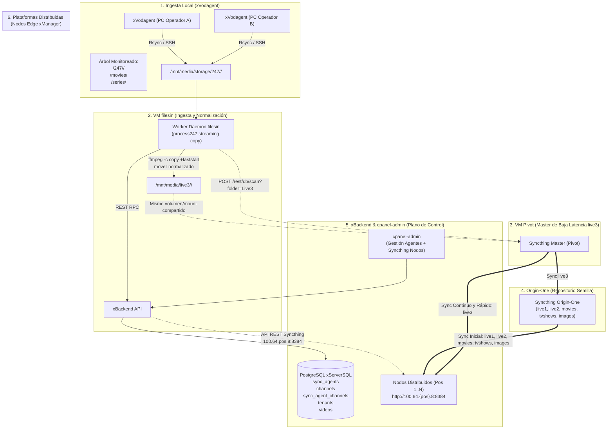

# PLAN MAESTRO: Upgrade de Canales FAST en xVodagent, xBackend y Orquestación Syncthing

> **Documento:** Plan Maestro y Especificación Técnica de Arquitectura  
> **Estado:** Borrador Aprobado para Especificación (SDD Fases 2, 4 y 5)  
> **Sistemas Afectados:** `xVodagent`, `xBackend`, `xServerSQL`, `cpanel-admin`, Servidores `filesin`, `Pivot`, `Origin-One` y Nodos Distribuidos (`xManager`)  
> **Fecha de Actualización:** 2026-10-14  
> **Doctrinas Aplicadas:** Británica (*Keep it Plain*), Alemana (*Gründlichkeit*), Rusa (*Nadezhnost*)  

---

## 1. Resumen Ejecutivo y Topología Global

Esta iniciativa estandariza la ingesta masiva, normalización atómica, control de versiones y distribución multi-nodo de contenidos para **Canales FAST (24/7)**, incorporando la gestión centralizada de los clústeres Syncthing en todas las plataformas del ecosistema.

### Topología del Ecosistema:


---

## 2. Decisiones Arquitectónicas Confirmadas (R1, R2, R3)

1. **Ubicación del Worker de Normalización (R1):**
   - El procesamiento corre como un **servicio en `filesin`**, procesando los archivos en la medida que van llegando a `/mnt/media/storage/247/`.
   - No sobrecarga `xBackend` con tareas intensivas de I/O de disco.
2. **Inmutabilidad de Contenidos Antiguos y Conmutación Manual (R2):**
   - Los archivos existentes en `/mnt/media/live1/` y `/mnt/media/live2/` **no se tocan, no se renombran ni se eliminan**.
   - El flujo contempla una **conmutación manual en `cpanel-admin`** de `live1`/`live2` hacia `live3` cuando el operador verifique que todos los servidores distribuidos han completado la sincronización.
3. **Relación N-a-N Canales y Agentes (R3):**
   - Un canal FAST puede estar asignado simultáneamente a múltiples agentes `xVodagent` (ej. varios operadores editando y subiendo contenido para el mismo canal).
   - Un agente puede tener asignados múltiples canales.
4. **Pipeline FFmpeg Ultrarrápido (`-c copy`):**
   - No se realiza re-encoding puesto que el material ya fue transcodificado previamente.
   - Perfil oficial basado en `process247.sh`:
     ```bash
     ffmpeg -loglevel quiet -nostdin -analyzeduration 10000000 -probesize 5000000 -y -i "$infile" \
         -c copy -movflags +faststart "$outfile"
     ```
   - Nomenclatura normalizada: `${dest}_${idx}.mp4` (ej. `retro_knigth_rider_0001.mp4`).

---

## 3. Modelo de Base de Datos (xServerSQL)

### 3.1. Tabla Relacional N-a-N: `sync_agent_channels`
Resuelve la relación muchos a muchos entre `sync_agents` y `channels` con tipos de datos correctos (`UUID` y `NUMERIC`):

```sql
-- Migration: 0009_sync_agent_channels.sql
CREATE TABLE IF NOT EXISTS public.sync_agent_channels (
    id UUID PRIMARY KEY DEFAULT gen_random_uuid(),
    agent_id UUID NOT NULL REFERENCES public.sync_agents(id) ON DELETE CASCADE,
    channel_id NUMERIC NOT NULL REFERENCES public.channels(channelid) ON DELETE CASCADE,
    remote_folder_path VARCHAR(255) NOT NULL, -- ej: '247/retro_knigth_rider'
    local_subpath VARCHAR(255) NOT NULL,      -- ej: '247/retro_knigth_rider'
    is_active BOOLEAN DEFAULT TRUE,
    created_at TIMESTAMP WITH TIME ZONE DEFAULT NOW(),
    updated_at TIMESTAMP WITH TIME ZONE DEFAULT NOW(),
    CONSTRAINT uq_agent_channel UNIQUE(agent_id, channel_id)
);

CREATE INDEX IF NOT EXISTS idx_sync_agent_channels_agent ON public.sync_agent_channels(agent_id);
CREATE INDEX IF NOT EXISTS idx_sync_agent_channels_channel ON public.sync_agent_channels(channel_id);
```

### 3.2. Procedimientos Almacenados PL/pgSQL
- **`syncagentchannelassign`**: Asigna un canal FAST a un agente. Valida `sourcetype = 'fast'`.
- **`syncagentchannelunassign`**: Desvincula un canal FAST de un agente.
- **`syncagentchannellist`**: Lista canales vinculados a un agente con telemetría de archivos subidos.
- **`syncagentgetchannelsforagent`**: Endpoint consumido por `xVodagent` para conocer sus subcarpetas asignadas.
- **`syncagentswitchtolive3`**: Permite al administrador conmutar formalmente el canal de `live1`/`live2` a `live3` tras confirmar la sincronización.

---

## 4. Arquitectura de xVodagent (Agente Local)

### 4.1. Estructura de Directorios por Defecto
Al arrancar, `xVodagent` verifica o crea automáticamente en `monitoredBasePath`:
```text
<MONITORED_BASE_PATH>/
  ├── 247/
  ├── movies/
  └── series/
```
*En Fase 1, solo se procesa activamente la raíz `/247/` y sus subcarpetas mapeadas.*

### 4.2. Creación Automática de Carpetas de Canales Asignados
- El agente consulta periódicamente `GET /api/v1/sync-agent/channel-mappings` (o el RPC actualizado).
- Para cada canal asignado, crea localmente la carpeta `<MONITORED_BASE_PATH>/247/<channel_path>/`.
- Regla Estricta: Archivos depositados fuera de subcarpetas autorizadas no se transfieren y se registran como `unmapped`.

### 4.3. Flujo de Transferencia Local
1. Detección exclusiva de extensiones `.mp4`.
2. Estabilidad de tamaño (5 segundos invariables).
3. Hash streaming `xxHash64` y verificación en `xBackend` (`/api/v1/sync-agent/check-duplicate`).
4. Transferencia mediante Rsync/SSH hacia `filesin:/mnt/media/storage/247/<channel_path>/`.
5. Notificación de fin de subida en `media_upload_logs`.

---

## 5. Worker de Ingesta y Normalización en `filesin`

1. **Ubicación:** Servicio Systemd en la VM `filesin`.
2. **Monitoreo:** Vigila `/mnt/media/storage/247/<channel_path>/`.
3. **Control de Duplicados e Índices:** Utiliza un archivo índice `.files` y/o consulta a la base de datos para obtener el correlativo `${dest}_${idx}.mp4`.
4. **Procesamiento:**
   ```bash
   ffmpeg -loglevel quiet -nostdin -analyzeduration 10000000 -probesize 5000000 -y -i "$infile" \
       -c copy -movflags +faststart "$outfile_temp"
   ```
5. **Movimiento a Playout:** Mueve el archivo a `/mnt/media/live3/<channel_path>/${dest}_${idx}.mp4`.
6. **Extracción ffprobe y Registro SQL:** Extrae duración y streams técnicos, registra en `videos` y vincula a `channelvideos`.
7. **Disparo Syncthing en Pivot:** Ejecuta un webhook HTTP hacia `Pivot`:
   ```bash
   curl -s -X POST -H "X-API-Key: <PIVOT_API_KEY>" "http://localhost:8384/rest/db/scan?folder=Live3&sub=<channel_path>"
   ```

---

## 6. Paso 2: Orquestación de Syncthing en xBackend para Todas las Plataformas

### 6.1. Topología y Roles de Clúster
- **`Origin-One` (Device ID: `GMGVA2R-6L74ZMJ-S753IB7-QWVCDO2-IX6EKDV-JCRDJIK-Z7NWX3Z-QSVJ5AF`):**
  - Repositorio central que alimenta la copia inicial a nuevas plataformas de: `Live1`, `Live2`, `Movies`, `TvShows`, e `images`.
  - En cuanto a `Live3`, ahora actúa como **receptor** desde `Pivot`.
- **`Pivot` (Device ID: `AM5VNFY-OJ2AL7C-EIIVRQY-A7KLWF7-ZC2FVLY-GVAGES3-V6VZNKL-P4WUFQF`):**
  - Master exclusivo y de alta velocidad para la carpeta `Live3`.
  - Alimenta directamente a `Origin-One` y a todos los nodos remotos.
- **Nodos Distribuidos (Edge Nodes):**
  - Dirección IP fija: `http://100.64.{tenant.position}.8:8384`
  - Reciben carpetas históricas desde `Origin-One` y actualizaciones rápidas de `Live3` desde `Pivot`.

### 6.2. Módulo de Gestión Syncthing en `xBackend`
Se crea el controlador `SyncthingController` en `xBackend` con las siguientes capacidades:

1. **Almacenamiento de Credenciales:**  
   Almacenar `syncthing_apikey` por plataforma en `tenants.options->>'syncthing_apikey'` (ej. `m9gQjgSasMmrccWLvDwM4WoaHTdxGuof`).
2. **Health Check y Telemetría del Nodo:**  
   `GET /v3/tenants/:tenantid/syncthing/status`
   - Consulta `http://100.64.{position}.8:8384/rest/system/status`.
   - Consulta estado de carpetas: `GET /rest/db/status?folder=Live3` y `GET /rest/db/completion`.
   - Informa en el panel si el nodo está al día (100% synced), sincronizando o pausado.
3. **Pausar / Reanudar Sincronización:**  
   `POST /v3/tenants/:tenantid/syncthing/pause` (`{"paused": true | false}`)
   - Permite mitigar saturaciones de ancho de banda durante horas pico o mantenimientos.
4. **Auto-Aprovisionamiento de Pares (`Bootstrap Peers`):**  
   `POST /v3/tenants/:tenantid/syncthing/bootstrap-peers`
   - Consulta `GET /rest/config/devices` en el nodo remoto.
   - Si falta `Pivot` o `Origin-One`, los agrega automáticamente con sus IDs canónicos.
   - Vincula las carpetas (`Live3`, `Live1`, `Live2`, `Movies`, `TvShows`, `images`) a los peers correspondientes vía `PUT /rest/config/folders`.
5. **Gestión de la Carpeta de Imágenes (`images`):**  
   - Monitorear que la carpeta de `images` se encuentre compartida y activa entre `Origin-One` y el nodo.

---

## 7. Matriz Defensiva de Pruebas (Filtro Ruso L1/L2/L3)

### Nivel 1: Edge Cases y Datos Hostiles
- Caracteres especiales o acentos en nombres de archivo de video (validar normalización POSIX estricta a `${dest}_${idx}.mp4`).
- Archivos `.mp4` corruptos o incompletos: FFmpeg con copia directa falla si los headers MOOV/MDAT están dañados; el worker debe capturar el error y marcar el archivo como rechazado sin moverlo a `live3`.
- Intentos de subir archivos a un canal no asignado al agente.

### Nivel 2: Integración y Contratos de Red
- Verificación estricta de compilación TypeScript (`npx tsc --noEmit`) en `xVodagent` y `xBackend`.
- Verificación de timeout y reintentos en las llamadas REST a los Syncthing remotos (`100.64.{pos}.8:8384`) para no bloquear el backend si un nodo está offline.
- Procedimientos PL/pgSQL: pruebas con `channelid` inexistentes o repetidos respetando las restricciones UNIQUE.

### Nivel 3: Resiliencia y Fallas Masivas
- Caída de la VM `filesin`: los agentes deben almacenar en cola local y reintentar la subida vía Rsync al recuperarse la red.
- Caída temporal de `Pivot`: los nodos edge continúan emitiendo el contenido que ya tienen en `/mnt/media/live3` sin interrupción de playout.
- Desconexión del nodo Syncthing remoto a mitad de una sincronización: Syncthing reanuda por bloques sin duplicación.

---

## 8. Fases y Plan de Tareas de Ejecución

- [ ] **Fase 1: Capa de Datos (xServerSQL)**
  - [ ] Escribir migración DDL `0009_sync_agent_channels.sql` con la tabla N-a-N.
  - [ ] Implementar funciones PL/pgSQL: `syncagentchannelassign`, `syncagentchannelunassign`, `syncagentchannellist`, `syncagentgetchannelsforagent`, `syncagentswitchtolive3`.
- [ ] **Fase 2: Backend (xBackend)**
  - [ ] Crear `controllers/syncthing.ts` para orquestar los nodos Syncthing (`100.64.{pos}.8:8384`).
  - [ ] Actualizar `controllers/vodagent.ts` para soportar las nuevas rutas de asignación N-a-N.
  - [ ] Registrar rutas en `server/router.ts`.
- [ ] **Fase 3: Agente Local (xVodagent)**
  - [ ] Crear en arranque las carpetas base `/247`, `/movies`, `/series`.
  - [ ] Crear dinámicamente las subcarpetas `/247/<channel_path>/` según los canales asignados.
  - [ ] Restringir el escáner a `/247/` y sus canales autorizados.
- [ ] **Fase 4: Pipeline en Servidor filesin**
  - [ ] Implementar el daemon de monitoreo e ingesta en `filesin` adaptando `process247.sh` (`ffmpeg -c copy -movflags +faststart`).
  - [ ] Mover a `/mnt/media/live3/` e invocar webhook de escaneo en `Pivot` (`/rest/db/scan`).
- [ ] **Fase 5: Panel Administrativo (cpanel-admin)**
  - [ ] Vista de gestión de agentes: selector de canales FAST (N-a-N) y estado de subida.
  - [ ] Vista de gestión Syncthing por Tenant: indicador de estado del nodo, botón de sincronizar peers (`Origin-One`/`Pivot`), pausar/reanudar y botón de conmutación manual a `live3`.
