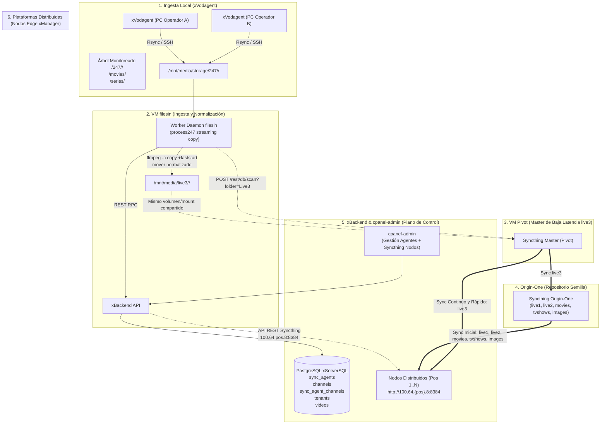

# REQ-2026-003: Upgrade de Canales FAST en xVodagent, xBackend y Orquestación Syncthing

> **Documento:** Especificación Técnica Aprobada (SDD Fase 2, 4 y 5)  
> **Estado:** APROBADO / EN EJECUCIÓN  
> **Sistemas Afectados:** `xVodagent`, `xBackend`, `xServerSQL`, `cpanel-admin`, Servidores `filesin`, `Pivot`, `Origin-One` y Nodos Distribuidos (`xManager`)  
> **Fecha de Aprobación:** 2026-10-14  
> **Doctrinas Aplicadas:** Británica (*Keep it Plain*), Alemana (*Gründlichkeit*), Rusa (*Nadezhnost*)  

---

## 1. Resumen Ejecutivo y Topología Global

Esta iniciativa estandariza la ingesta masiva, normalización atómica, control de versiones y distribución multi-nodo de contenidos para **Canales FAST (24/7)**, incorporando la gestión centralizada de los clústeres Syncthing en todas las plataformas del ecosistema.

### Topología del Ecosistema:


---

## 2. Decisiones Arquitectónicas Confirmadas (R1, R2, R3)

1. **Ubicación del Worker de Normalización (R1):**
   - El procesamiento corre como un **servicio en `filesin`**, procesando los archivos en la medida que van llegando a `/mnt/media/storage/247/`.
   - No sobrecarga `xBackend` con tareas intensivas de I/O de disco.
2. **Inmutabilidad de Contenidos Antiguos y Conmutación Manual (R2):**
   - Los archivos existentes en `/mnt/media/live1/` y `/mnt/media/live2/` **no se tocan, no se renombran ni se eliminan**.
   - El flujo contempla una **conmutación manual en `cpanel-admin`** de `live1`/`live2` hacia `live3` cuando el operador verifique que todos los servidores distribuidos han completado la sincronización.
3. **Relación N-a-N Canales y Agentes (R3):**
   - Un canal FAST puede estar asignado simultáneamente a múltiples agentes `xVodagent` (ej. varios operadores editando y subiendo contenido para el mismo canal).
   - Un agente puede tener asignados múltiples canales.
4. **Pipeline FFmpeg Ultrarrápido (`-c copy`):**
   - No se realiza re-encoding puesto que el material ya fue transcodificado previamente.
   - Perfil oficial basado en `process247.sh`:
     ```bash
     ffmpeg -loglevel quiet -nostdin -analyzeduration 10000000 -probesize 5000000 -y -i "$infile" \
         -c copy -movflags +faststart "$outfile"
     ```
   - Nomenclatura normalizada: `${dest}_${idx}.mp4` (ej. `retro_knigth_rider_0001.mp4`).

---

## 3. Modelo de Base de Datos (xServerSQL)

### 3.1. Tabla Relacional N-a-N: `sync_agent_channels`
Resuelve la relación muchos a muchos entre `sync_agents` y `channels` con tipos de datos correctos (`UUID` y `NUMERIC`):

```sql
-- Migration: 0009_sync_agent_channels.sql
CREATE TABLE IF NOT EXISTS public.sync_agent_channels (
    id UUID PRIMARY KEY DEFAULT gen_random_uuid(),
    agent_id UUID NOT NULL REFERENCES public.sync_agents(id) ON DELETE CASCADE,
    channel_id NUMERIC NOT NULL REFERENCES public.channels(channelid) ON DELETE CASCADE,
    remote_folder_path VARCHAR(255) NOT NULL, -- ej: '247/retro_knigth_rider'
    local_subpath VARCHAR(255) NOT NULL,      -- ej: '247/retro_knigth_rider'
    is_active BOOLEAN DEFAULT TRUE,
    created_at TIMESTAMP WITH TIME ZONE DEFAULT NOW(),
    updated_at TIMESTAMP WITH TIME ZONE DEFAULT NOW(),
    CONSTRAINT uq_agent_channel UNIQUE(agent_id, channel_id)
);

CREATE INDEX IF NOT EXISTS idx_sync_agent_channels_agent ON public.sync_agent_channels(agent_id);
CREATE INDEX IF NOT EXISTS idx_sync_agent_channels_channel ON public.sync_agent_channels(channel_id);
```

### 3.2. Procedimientos Almacenados PL/pgSQL
- **`syncagentchannelassign`**: Asigna un canal FAST a un agente. Valida `sourcetype = 'fast'`.
- **`syncagentchannelunassign`**: Desvincula un canal FAST de un agente.
- **`syncagentchannellist`**: Lista canales vinculados a un agente con telemetría de archivos subidos.
- **`syncagentgetmappings`**: Endpoint consumido por `xVodagent` para conocer sus subcarpetas asignadas.
- **`syncagentswitchtolive3`**: Permite al administrador conmutar formalmente el canal de `live1`/`live2` a `live3` tras confirmar la sincronización.
- **`tenantsyncthingconfig`**: Consulta y actualización de credenciales e IPs de Syncthing por tenant.

---

## 4. Estado de Avance por Fases

- [x] **Fase 1: Capa de Datos (xServerSQL)**
  - [x] Escribir migración DDL `0009_sync_agent_channels.sql` con la tabla N-a-N.
  - [x] Implementar función PL/pgSQL: `syncagentchannelassign.sql`.
  - [x] Implementar función PL/pgSQL: `syncagentchannelunassign.sql`.
  - [x] Implementar función PL/pgSQL: `syncagentchannellist.sql`.
  - [x] Actualizar función PL/pgSQL: `syncagentgetmappings.sql`.
  - [x] Implementar función PL/pgSQL: `syncagentswitchtolive3.sql`.
  - [x] Implementar función PL/pgSQL: `tenantsyncthingconfig.sql`.
  - [x] Actualizar función PL/pgSQL: `syncagentadmin.sql`.
- [x] **Fase 2: Backend (xBackend)**
  - [x] Crear `controllers/syncthing.ts` para orquestar los nodos Syncthing usando la columna `cpanel` (`.2` -> `.8:8384`).
  - [x] Actualizar `controllers/vodagent.ts` para soportar las nuevas rutas de asignación N-a-N y switch a `live3`.
  - [x] Crear `server/routersyncthing.ts` y montar rutas en `server/server.ts` / `xserver.ts`.
  - [x] Verificación de compilación TypeScript estricta (`npx tsc --noEmit` exitoso con código 0).
- [x] **Fase 3: Agente Local (xVodagent)**
  - [x] Crear en arranque las carpetas base `/247`, `/movies`, `/series`.
  - [x] Crear dinámicamente las subcarpetas `/247/<channel_path>/` según los canales asignados.
  - [x] Restringir el escáner a `/247/` y sus canales autorizados.
  - [x] Verificación de pruebas unitarias y compilación (`npm run test` y `npm run build` con código 0).
- [x] **Fase 4: Pipeline en Servidor filesin**
  - [x] Implementar el daemon de monitoreo e ingesta en `filesin` adaptando `process247.sh` (`ffmpeg -c copy -movflags +faststart`).
  - [x] Mover a `/mnt/media/live3/` e invocar webhook de escaneo en `Pivot` (`/rest/db/scan`).
  - [x] Crear archivo unit systemd `process247_watcher.service`.
- [x] **Fase 5: Panel Administrativo (cpanel-admin)**
  - [x] Vista de gestión de agentes: selector de canales FAST (N-a-N), visualización de estado de subida y botón de conmutación a `live3`.
  - [x] Vista de gestión Syncthing por Tenant: botón independiente en tabla de tenants, modal dedicado de telemetría de nodo, botón de 1-clic para sincronizar peers (`Origin-One`/`Pivot`), pausar/reanudar y forzar escaneo `Live3`.

