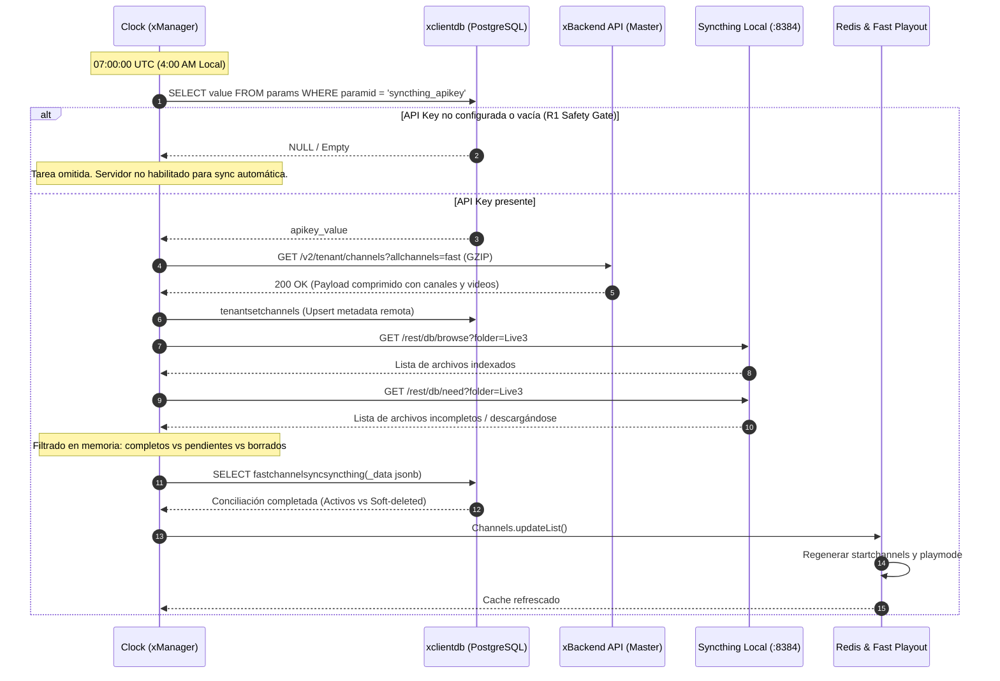

# Documento de Especificación Técnica: Sincronización Syncthing API para Canales 24/7 en xManager

| Metadato | Detalle |
| :--- | :--- |
| **ID Requerimiento:** | `REQ-2026-004` |
| **Sistema Destino:** | `Cross_System` (`xManager`, `xBackend`, `xClientSQL`) |
| **Estado:** | `02_Aprobado` |
| **Fecha de Creación:** | 2026-10-17 |
| **Última Actualización:** | 2026-10-17 |
| **Autor(es):** | Arquitecto de Software & Evaluador Hostil (Planning-X) |

---

## 1. Resumen Ejecutivo y Justificación de Negocio

Actualmente, los nodos distribuidos de emisión (`xManager`) realizan un escaneo de disco físico recurrente (`fs.readdirSync` en `channelfiles.ts`) sobre `/mnt/media/live/` para averiguar qué archivos de video están presentes. Este mecanismo genera:
1. Alto consumo innecesario de I/O de disco.
2. Ceguera ante transferencias incompletas (riesgo de reproducir archivos que Syncthing todavía está descargando).
3. Ineficiencia en la detección de borrados y sobrecarga en la sincronización de metadata debido a un bucle obsoleto con `limit = 1` por canal.

**Solución propuesta:**
Reemplazar el escaneo físico de disco por la consulta directa a la **API REST local de Syncthing** (`127.0.0.1:8384`), aprovechando que `xManager` y Syncthing conviven en la misma instancia.
- La metadata canónica de negocio proviene de `xBackend` mediante descarga consolidada y comprimida con GZIP.
- La disponibilidad física del archivo la certifica Syncthing localmente.
- Se implementa un scheduler diario automático a las **07:00:00 UTC (04:00 AM hora local)** que concilia, activa archivos presentes y desactiva (*soft-delete*) los borrados.
- **Circuit-breaker de seguridad:** Si el parámetro `syncthing_apikey` no está configurado en la tabla `params`, la tarea se omite para evitar habilitar servidores en etapa de comisionamiento.

---

## 2. Filtro Doctrinal y Cuestionamiento Inicial (Filtro Británico)

### 2.1. ¿Cuál es la necesidad real identificada?
Contar con una conciliación exacta, rápida y sin impacto en disco entre lo que el orquestador (`xBackend`) planifica para cada canal 24/7 y los archivos físicos que el clúster Syncthing ha entregado efectivamente en el nodo edge.

### 2.2. Supuestos descartados durante el diseño:
- **Descartado:** Seguir recorriendo el sistema de archivos con `fs.readdirSync`. *Motivo:* Syncthing ya mantiene el inventario en memoria y base LevelDB local; consultar su API es instantáneo y libre de I/O de disco.
- **Descartado:** Hard-delete directo en base de datos. *Motivo:* Un archivo que se borra temporalmente o se re-sincroniza después no debe perder su asociación histórica de metadata (R2: Soft-delete defensivo).
- **Descartado:** Detección de API Key desde archivos XML en disco. *Motivo:* La tabla `params` de la base local es la fuente única de verdad aprobada por el operador (R1).
- **Descartado:** Bucle secuencial `limit = 1` en `channelsV2.ts`. *Motivo:* Complejidad accidental y lentitud masiva. Se migra a lote consolidado con compresión GZIP.

### 2.3. ¿Por qué es la solución más directa?
Aprovecha herramientas existentes sin agregar ningún nuevo servicio:
1. `Clock.ts` existente en `xManager` se calibra a las 07:00 UTC.
2. Syncthing ya corre en el puerto 8384.
3. Se añade un único procedimiento almacenado atómico en `xClientSQL` (`fastchannelsyncsyncthing`) para la conciliación en base de datos.

---

## 3. Alcance y Límites del Requerimiento

### 3.1. En Alcance (In Scope)
- [ ] **Configuración Segura (R1):** Lectura estricta de `syncthing_url` y `syncthing_apikey` desde la tabla `params` de `xclientdb`. Si falta la clave o está vacía, abortar silenciosamente con log informativo.
- [ ] **Optimización API Metadata (xBackend $\rightarrow$ xManager):**
  - Eliminar el paginado forzado `limit = 1` en `channelsV2.ts` para canales FAST.
  - Asegurar recepción de payload comprimido (GZIP) con `Accept-Encoding: gzip, deflate`.
- [ ] **Módulo Cliente Syncthing en xManager (`src/base/syncthingLocal.ts`):**
  - Consulta a `GET /rest/db/browse?folder=Live3`.
  - Consulta a `GET /rest/db/need?folder=Live3` para aislar archivos en progreso de descarga.
- [ ] **Procedimiento SQL Conciliador en xClientSQL (`fastchannelsyncsyncthing`):**
  - Activar videos presentes al 100%: `downloadstatus = 'downloaded'`, `status = 'enabled'`, `channelvideos.status = 'present'`.
  - Soft-delete (R2): Archivos borrados en Syncthing (`deleted: true`) o no listados en `browse` pasan a `videos.status = 'disabled'`, `videos.downloadstatus = 'forDelete'` y se desvinculan de la emisión activa.
- [ ] **Scheduler 07:00 UTC en `Clock.ts`:**
  - Cálculo de retardo exacto hacia las 07:00:00 UTC (4:00 AM hora local).
  - Ejecución diaria no bloqueante protegida por mutex (`isSyncing`).
- [ ] **Actualización de Playout:**
  - Invocación automática de `Channels.updateList()` tras la conciliación para regenerar Redis y notificar a la API de reload.

### 3.2. Fuera de Alcance (Out of Scope - *YAGNI*)
- Escaneo de carpetas `movies` o `tvshows` por Syncthing API en este requerimiento (R3 limita la tarea estrictamente a la carpeta `Live3`).
- Re-transcodificación o manipulación de archivos de video dentro de `xManager`.

---

## 4. Arquitectura y Flujo de Datos



---

## 5. Contratos de Datos y Esquema DDL (Filtro Alemán)

### 5.1. Parámetros en `xclientdb` (Tabla `params`)
Se emplea la clave `paramid = 'updates.vod.files'` con estructura JSON estandarizada:
```json
{
  "syncthing_apikey": "API_KEY",
  "update_fast": true,
  "update_movies": false,
  "update_series": false
}
```
- **Regla de Evaluación en `Clock.ts`:**
  1. Si `updates.vod.files` no existe o no tiene un JSON válido, la tarea **no se ejecuta**.
  2. Si `syncthing_apikey` es nula, vacía o inexistente, la tarea **no se ejecuta** (R1: salvaguarda para servidores no preparados).
  3. Si `update_fast === true`: ejecuta la sincronización de canales FAST (Syncthing local API en `Live3` + conciliación SQL `fastchannelsyncsyncthing` + refresco de Redis).
  4. Si `update_movies === true`: ejecuta la sincronización de películas VOD (`Channels.getmoviesInternal`).
  5. Si `update_series === true`: ejecuta la sincronización de series VOD (`Channels.gettvshowsInternal`).

### 5.2. Contratos API para Control Manual (xBackend $\rightarrow$ xManager)

#### Endpoint en `xManager` (`routerclient.ts` / `routercpanel.ts`):
- **Ruta:** `POST /v2/admin/updates/vod-files`
- **Headers:** `apikey: <tenant_apikey>`
- **Payload:**
  ```json
  {
    "syncthing_apikey": "API_KEY",
    "update_fast": true,
    "update_movies": false,
    "update_series": false,
    "run_now": false
  }
  ```
- **Comportamiento:** Guarda/actualiza el objeto en `params` bajo `updates.vod.files`. Si `run_now: true`, ejecuta la secuencia inmediatamente en segundo plano.

#### Endpoint en `xBackend` (`routercpanel.ts` / `tenants.ts`):
- **Ruta:** `POST /v3/tenants/:tenantid/updates/vod-files`
- **Comportamiento:** Resuelve la URL del nodo `xManager` (`tenantgetadminidentity`) y reenvía el payload JSON hacia `${cpanelHost}/v2/admin/updates/vod-files`.

### 5.3. Procedimiento Almacenado en `xClientSQL`
Firma RPC estandarizada:
```sql
CREATE OR REPLACE FUNCTION public.fastchannelsyncsyncthing(
    _data jsonb,      -- Array de archivos: [{ path, filename, size, status: 'available'|'deleted' }]
    _params jsonb,    -- { channelid?: numeric, folder?: varchar }
    _operator jsonb   -- Auth context
) RETURNS jsonb
LANGUAGE plpgsql
AS $$
DECLARE
    _file jsonb;
    _filename varchar;
    _slug varchar;
    _file_status varchar;
    _activated_count integer := 0;
    _deactivated_count integer := 0;
    _vid_record record;
BEGIN
    -- 1. Marcar temporalmente registros FAST para verificación de ausencia
    -- 2. Procesar lote de archivos reportados por Syncthing
    FOR _file IN SELECT * FROM jsonb_array_elements(_data) LOOP
        _filename := trim(jgk(_file, 'filename', ''));
        _slug := trim(jgk(_file, 'slug', ''));
        _file_status := jgk(_file, 'status', 'available');

        IF (_filename <> '') THEN
            IF (_file_status = 'available') THEN
                -- Habilitar video y asociar como 'present'
                UPDATE videos 
                SET downloadstatus = 'downloaded',
                    status = 'enabled',
                    modified_at = CURRENT_TIMESTAMP
                WHERE filename = _filename;

                UPDATE channelvideos cv
                SET status = 'present',
                    modified_at = CURRENT_TIMESTAMP
                FROM channels c
                WHERE cv.channelid = c.channelid 
                  AND cv.id = (SELECT id FROM videos WHERE filename = _filename LIMIT 1)
                  AND c.sourcetype = 'fast';

                _activated_count := _activated_count + 1;
            ELSE
                -- Soft-Delete (R2) para archivos borrados
                UPDATE videos 
                SET downloadstatus = 'forDelete',
                    status = 'disabled',
                    modified_at = CURRENT_TIMESTAMP
                WHERE filename = _filename;

                UPDATE channelvideos cv
                SET status = 'disabled',
                    modified_at = CURRENT_TIMESTAMP
                FROM channels c
                WHERE cv.channelid = c.channelid 
                  AND cv.id = (SELECT id FROM videos WHERE filename = _filename LIMIT 1)
                  AND c.sourcetype = 'fast';

                _deactivated_count := _deactivated_count + 1;
            END IF;
        END IF;
    END LOOP;

    RETURN jsonb_build_object(
        'status', 'success',
        'activated', _activated_count,
        'deactivated', _deactivated_count,
        'synced_at', CURRENT_TIMESTAMP
    );
END;
$$;
```

---

## 6. Filtro Ruso: Matriz de Verificación y Resiliencia (L1 / L2 / L3)

### Nivel 1: Casos Borde y Pruebas Hostiles (Edge Cases)
- **Caso 1.1: Syncthing API caído o timeout:** El módulo en `xManager` debe tener un timeout defensivo de 5.000 ms. Si Syncthing no responde, la sincronización se aborta registrando error en log, sin tumbar el proceso `xmanager`.
- **Caso 1.2: Archivos a medio descargar:** Un archivo listado en `browse` que además aparece en `need` **no** debe marcarse como `available`. Debe permanecer en `pending`.
- **Caso 1.3: Archivo en disco pero sin metadata en `videos`:** Syncthing tiene el archivo físico pero `xBackend` nunca envió la metadata. La función SQL ignora o registra advertencia; no inserta videos sin metadatos.
- **Caso 1.4: Slug con subcarpetas anidadas:** Soporte para rutas tipo `247/canal_slug/archivo_001.mp4` o `canal_slug/archivo_001.mp4`.

### Nivel 2: Contratos de Integración y Validación de Tipos
- **Prueba 2.1:** Compilación TypeScript limpia en `xManager` (`npx tsc --noEmit`).
- **Prueba 2.2:** Descompresión GZIP transparente en la llamada HTTP de `xManager`.
- **Prueba 2.3:** Integridad referencial en PostgreSQL: ninguna operación transaccional puede violar claves foráneas entre `channelvideos` y `videos`.

### Nivel 3: Resiliencia, Concurrencia y Recuperación ante Desastres
- **Prueba 3.1 (Anti-Colisión / Mutex):** Si el operador dispara un escaneo manual mientras el job de las 07:00 UTC está corriendo, el segundo intento es rechazado (`409 Conflict: Synchronization already in progress`).
- **Prueba 3.2 (Deriva Horaria / Time Drift):** El temporizador de `Clock.ts` recalcula la diferencia de milisegundos hacia `07:00:00 UTC` tras cada ejecución diaria para no verse afectado por desajustes de reloj.

---

## 7. Plan de Tareas de Implementación

- [x] **Tarea 1 (xClientSQL):** Crear función `fastchannelsyncsyncthing.sql` con soporte para activación masiva y soft-delete.
  - *Hecho cuando:* La función esté creada en `sql/xClientSQL/_Functions/Channels/fastchannelsyncsyncthing.sql` y pase pruebas unitarias en Postgres.
- [x] **Tarea 2 (xManager - Servicio Syncthing Local):** Crear `src/services/syncthingLocal.ts` con cliente HTTP hacia `127.0.0.1:8384` consumiendo `/rest/db/browse` y `/rest/db/need`.
  - *Hecho cuando:* El servicio resuelva la lista de archivos completos vs en progreso sin fallos de conexión.
- [x] **Tarea 3 (xManager - Optimización API Metadata):** Refactorizar `getchannelsInternal` en `src/controllers/channelsV2.ts` eliminando el bucle `limit = 1`, aumentando el lote y activando cabeceras GZIP.
  - *Hecho cuando:* La descarga de metadata se ejecute en 1 sola llamada comprimida y valide el payload recibido.
- [x] **Tarea 4 (xManager - Scheduler 07:00 UTC & Orquestación Multitarea):** Extender `src/base/clock.ts` con el cron/timer hacia las 07:00:00 UTC:
  - Leer y validar el JSON del parámetro `updates.vod.files`.
  - Si falta o `syncthing_apikey` está vacía, abortar silenciosamente.
  - Ejecutar condicionalmente: `update_fast` (Syncthing API + conciliación SQL), `update_movies` (`Channels.getmoviesInternal`), `update_series` (`Channels.gettvshowsInternal`) y refrescar Redis (`Channels.updateList`).
  - *Hecho cuando:* `Clock.ts` ejecute la secuencia orquestada respetando los flags del JSON `updates.vod.files`.
- [x] **Tarea 5 (xManager & xBackend - Endpoints de Control Remoto):**
  - Implementar en `xManager` (`controllers/admin.ts` / `routercpanel.ts`): `POST /v2/admin/updates/vod-files` para persistir `{ syncthing_apikey, update_fast, update_movies, update_series }` y soportar `run_now: true`.
  - Implementar en `xBackend` (`controllers/tenants.ts` / `routercpanel.ts`): `POST /v3/tenants/:tenantid/updates/vod-files` reenviando la orden a `xManager`.
  - *Hecho cuando:* Se pueda activar/desactivar la sincronización de un tenant vía HTTP y la respuesta confirme la persistencia en `params`.
- [x] **Tarea 6 (Verificación, Build y Memoria):** Pruebas de integración, verificación de tipos (`npx tsc`), compilación de ambos proyectos y actualización de `MEMORY.md`.
  - *Hecho cuando:* `xManager` y `xBackend` compilen con código de salida 0 y los `MEMORY.md` registren la arquitectura implementada.
