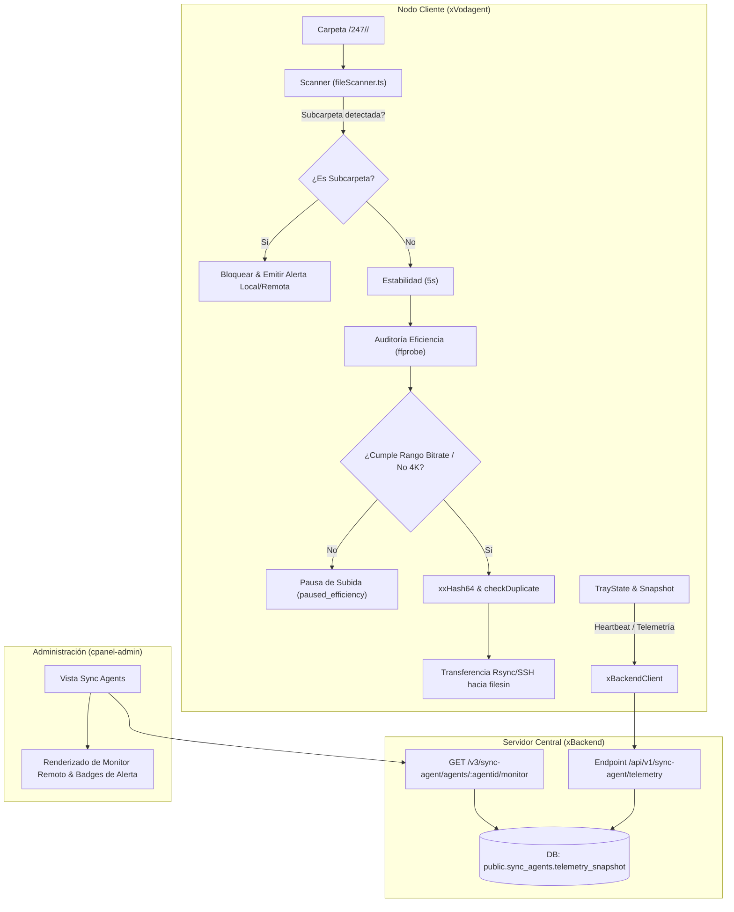

# REQ-2026-007: Guardrails de Ingesta, Eficiencia de Video y Monitor Remoto (xVodagent)

| Metadato | Detalle |
| :--- | :--- |
| **ID Requerimiento:** | `REQ-2026-007` |
| **Sistema Destino:** | `Cross_System` (`xVodagent` / `xBackend` / `cpanel-admin`) |
| **Estado:** | `02_Aprobado` |
| **Fecha de Creación:** | 2026-10-23 |
| **Última Actualización:** | 2026-10-23 |
| **Autor(es):** | Lead Architect (Planning-X / Antigravity) |

---

## 1. Resumen Ejecutivo y Justificación de Negocio

En el flujo de ingesta masiva de contenidos para canales 24/7 (FAST), los operadores suelen volcar archivos en carpetas locales monitoreadas por `xVodagent`. Actualmente se presentan tres problemáticas críticas en producción:
1. **Desorganización por Subcarpetas:** Los operadores crean subcarpetas arbitrarias dentro de los directorios de canal (ej. `/247/canal1/temporada_1/`), lo cual rompe la linealidad de escaneo y provoca fallas en la sincronización hacia `filesin` y Syncthing.
2. **Archivos Ineficientes (Bitrates desmedidos o deficientes):** Se cargan archivos en 4K o con bitrates desproporcionados (ej. 1080p a 8-12 Mbps, o 720p a 900 kbps), saturando el ancho de banda de subida del nodo y el almacenamiento de los servidores de emisión con contenido de pésimo rendimiento de codificación.
3. **Ceguera Operativa Remota:** Los nodos clientes corren en máquinas residenciales/operativas detrás de routers con IPs dinámicas o NAT privado sin Tailscale, impidiendo que el administrador del clúster (`cpanel-admin`) audite el estado del monitor web local del agente.

Este requerimiento especifica la **Fase 1** inmediata para blindar el agente con guardrails automáticos de profundidad de carpetas, análisis métrico de eficiencia mediante `ffprobe` (pausando la subida ante desvíos de bitrate o resolución 4K) y telemetría de monitoreo remoto hacia `xBackend` y `cpanel-admin`. Asimismo, sienta las bases para la **Fase 2** (estación web de transcodificación local integrada).

---

## 2. Filtro Doctrinal y Cuestionamiento Inicial (Engineering Rules)

### 2.1. Filtro Británico (*Keep it Plain* - Simplicidad Radical)
- **Eliminación de Redes Complejas:** Se descarta explícitamente el uso de Tailscale, túneles SSH reversos o WebSockets persistentes para el monitor web del operador. El agente ya cuenta con un canal saliente HTTP seguro hacia `xBackend` (heartbeat). Aprovechar este mismo canal saliente para enviar un snapshot comprimido de telemetría resuelve el acceso remoto con cero infraestructura adicional.
- **Sin Transcodificación Forzosa en Fase 1:** Si un archivo es ineficiente, el agente no gasta recursos de CPU/GPU intentando re-encodearlo en caliente de forma invisible; simplemente **pausa la subida** y avisa con claridad el motivo ("1080p a 6.2 Mbps excede el máximo de 4.5 Mbps"). La transcodificación asistida se delega a la herramienta interactiva de la Fase 2.

### 2.2. Filtro Alemán (*Gründlichkeit* - Rigor Estructural)
- **Contratos de Eficiencia Cuantitativos:** Todo archivo `.mp4` es inspeccionado con `ffprobe` previo a su cálculo de hash y transferencia.
- **Profundidad de Directorio Estricta:** La jerarquía en `247` solo admite: `<base>/247/<channel_folder>/<file.mp4>`. Toda profundidad $> 1$ respecto a `247/` es bloqueada de forma determinista.
- **Esquema de Snapshot Tipado:** `xBackend` recibe una estructura JSONB validada (`telemetry_snapshot`) que preserva estado de subidas activas, archivos pausados por política y alertas de directorio.

### 2.3. Filtro Ruso (*Nadezhnost* - Resiliencia L1/L2/L3)
- **L1 (Edge Cases):** Archivos sin pista de video, audios corruptos, videos 4K con bitrates bajos, containers MP4 con metadatos mal formados, nombres de subcarpetas con caracteres especiales.
- **L2 (Integración):** Verificación de binario `ffprobe` en el sistema (`command -v ffprobe` / `where ffprobe`). Fallback defensivo si el binario no devuelve JSON válido.
- **L3 (Resiliencia):** Tolerancia ante caídas de red: si el heartbeat con snapshot falla, el agente mantiene su cola y reintenta en el siguiente ciclo sin bloquear el hilo principal.

---

## 3. Alcance del Requerimiento

### 3.1. En Alcance (Fase 1)
- [x] **Filtro Anti-Subcarpetas en 24/7:**
  - Detección estricta de subdirectorios dentro de `<monitoredBasePath>/247/<channel_folder>/`.
  - Exclusión automática de escaneo para archivos ubicados en subcarpetas.
  - Registro de alerta visual local en el monitor del agente.
  - Reporte de anomalía `subfolder_alert` en el payload de telemetría a `xBackend`.
- [x] **Guardrail de Eficiencia de Video (`ffprobe`):**
  - Ejecución de `ffprobe` en modo JSON (`-select_streams v:0 -show_entries stream=width,height,duration,bit_rate -show_entries format=duration,size,bit_rate`).
  - Cálculo de bitrate real: $\text{Bitrate (Mbps)} = \frac{\text{sizeBytes} \times 8}{\text{durationSec} \times 1\,000\,000}$.
  - Políticas de admisión:
    - **HD (720p):** $1.8 \text{ Mbps} \le \text{Bitrate} \le 3.0 \text{ Mbps}$.
    - **Full HD (1080p):** $2.5 \text{ Mbps} \le \text{Bitrate} \le 4.5 \text{ Mbps}$.
    - **SD ($\le 480p/576p$):** Permitido si $\text{Bitrate} \le 1.8 \text{ Mbps}$.
    - **4K ($> 1080p$):** Bloqueo total inmediato.
  - Pausa de subida ante desvíos (`status: 'paused_efficiency'`) con descripción técnica del rechazo.
- [x] **Monitor Web Remoto (Telemetría Enriquecida):**
  - Generación de snapshot en `xVodagent` (`activeUpload`, `pausedFiles`, `alerts`, `stats`, `recentFiles`).
  - Ingesta en `xBackend` y persistencia en base de datos.
  - Endpoint `GET /v3/sync-agent/agents/:agentid/monitor` en `xBackend`.
  - Pestaña "Monitor Remoto" en `cpanel-admin` (componente `syncagents`) para visualizar la consola operativa de cada agente.

### 3.2. Fuera de Alcance (Reservado para Fase 2)
- Transcodificación automática en segundo plano (herramienta web con drag & drop, selección de pista en español y soporte GPU).
- Modificación de archivos crudos en disco.
- Integración con carpetas `/movies` y `/series` (acotado exclusivamente a `/247/` en este ciclo).

---

## 4. Arquitectura y Componentes Afectados



---

## 5. Contratos de Datos y Especificaciones Técnicas

### 5.1. DDL y Persistencia en PostgreSQL (`xServerSQL`)
Modificación de la tabla existente `sync_agents` en `xServerSQL`:
```sql
ALTER TABLE public.sync_agents 
ADD COLUMN IF NOT EXISTS telemetry_snapshot JSONB DEFAULT '{}'::jsonb,
ADD COLUMN IF NOT EXISTS has_alerts BOOLEAN DEFAULT FALSE,
ADD COLUMN IF NOT EXISTS alerts_summary JSONB DEFAULT '[]'::jsonb;

CREATE INDEX IF NOT EXISTS idx_sync_agents_has_alerts ON public.sync_agents(has_alerts);
```

### 5.2. Procedimiento Almacenado RPC: `syncagentupdatetelemetry`
*Ubicación:* `sql/xServerSQL/_Functions/SyncAgent/syncagentupdatetelemetry.sql`
- **Firma:** `syncagentupdatetelemetry(_data jsonb, _params jsonb, _operator jsonb) RETURNS jsonb`
- **Lógica:**
  - Extrae `agentid`, `telemetry_snapshot`, `alerts`.
  - Determina si `has_alerts = (jsonb_array_length(alerts) > 0)`.
  - Actualiza `sync_agents` registrando `last_heartbeat = now()`.

### 5.3. Contrato de Snapshot de Telemetría (Agente $\to$ xBackend)
Payload enviado en `POST /api/v1/sync-agent/telemetry`:
```json
{
  "agentId": "550e8400-e29b-41d4-a716-446655440000",
  "agentStatus": "scanning",
  "statusText": "Escaneando /247...",
  "activeUpload": {
    "filename": "show_musical_01.mp4",
    "channelSlug": "canal_musica",
    "sizeBytes": 524288000,
    "progressPercent": 45,
    "startedAt": "2026-10-23T09:40:00Z"
  },
  "pausedFiles": [
    {
      "filename": "concierto_4k_pesado.mp4",
      "channelSlug": "canal_musica",
      "localPath": "/media/247/canal_musica/concierto_4k_pesado.mp4",
      "sizeBytes": 8589934592,
      "width": 3840,
      "height": 2160,
      "duration": 3600.5,
      "bitrateMbps": 19.08,
      "reason": "Resolución 4K (3840x2160) no permitida en canales 24/7",
      "detectedAt": "2026-10-23T09:35:10Z"
    },
    {
      "filename": "clip_excesivo.mp4",
      "channelSlug": "canal_noticias",
      "localPath": "/media/247/canal_noticias/clip_excesivo.mp4",
      "sizeBytes": 600000000,
      "width": 1920,
      "height": 1080,
      "duration": 600.0,
      "bitrateMbps": 8.0,
      "reason": "Full HD a 8.00 Mbps supera el máximo permitido de 4.50 Mbps",
      "detectedAt": "2026-10-23T09:36:20Z"
    }
  ],
  "alerts": [
    {
      "type": "unauthorized_subfolder",
      "channelSlug": "canal_musica",
      "subfolderPath": "247/canal_musica/temporada_01",
      "message": "Subcarpeta detectada en canal 24/7. Mueva los archivos directamente a la raíz del canal.",
      "detectedAt": "2026-10-23T09:30:00Z"
    }
  ],
  "stats": {
    "totalCompleted": 142,
    "totalDuplicates": 18,
    "totalFailed": 1,
    "totalPausedEfficiency": 2,
    "bytesUploaded": 78945612300
  },
  "freeDiskSpaceGb": 45.2,
  "timestamp": "2026-10-23T09:41:00Z"
}
```

---

## 6. Lógica de Inspección y Guardrails en `xVodagent`

### 6.1. Algoritmo de Detección de Subcarpetas (`fileScanner.ts`)
```typescript
export interface ScanResult {
  validFiles: string[];
  subfolderAlerts: Array<{ channelSlug: string; subfolderPath: string }>;
}

export async function scan247DirectoryStrict(base247Dir: string): Promise<ScanResult> {
  const result: ScanResult = { validFiles: [], subfolderAlerts: [] };
  if (!fs.existsSync(base247Dir)) return result;

  const channelEntries = await fs.promises.readdir(base247Dir, { withFileTypes: true });
  for (const channelEntry of channelEntries) {
    if (!channelEntry.isDirectory()) continue;
    const channelSlug = channelEntry.name;
    const channelDir = path.join(base247Dir, channelSlug);

    const items = await fs.promises.readdir(channelDir, { withFileTypes: true });
    for (const item of items) {
      const fullPath = path.join(channelDir, item.name);
      if (item.isDirectory()) {
        // Bloquear subcarpeta y alertar
        result.subfolderAlerts.push({
          channelSlug,
          subfolderPath: path.relative(base247Dir, fullPath).replace(/\\/g, '/')
        });
      } else if (item.isFile() && isMp4File(fullPath)) {
        result.validFiles.push(fullPath);
      }
    }
  }
  return result;
}
```

### 6.2. Módulo de Inspección FFprobe (`src/scanner/efficiencyChecker.ts`)
```typescript
export interface EfficiencyCheckResult {
  isCompliant: boolean;
  width: number;
  height: number;
  duration: number;
  bitrateMbps: number;
  reason?: string;
}

export async function checkVideoEfficiency(filePath: string): Promise<EfficiencyCheckResult> {
  // Ejecutar ffprobe para extraer dimensiones, duración y bitrate de contenedor y stream
  // Si resolución > 1080p (ej. 4K): isCompliant = false, reason = '4K no permitido'
  // Si resolución == 1080p: rango [2.5, 4.5] Mbps. Si fuera: isCompliant = false
  // Si resolución == 720p: rango [1.8, 3.0] Mbps. Si fuera: isCompliant = false
  // Si resolución <= 480p/576p: máx 1.8 Mbps. Si mayor: isCompliant = false
}
```

---

## 7. Plan de Implementación y Tareas Atómicas

### 7.1. Backend y Base de Datos (`xBackend` / `sql`)
- [ ] **Tarea 1.1:** Migración DDL en `sql/` para agregar `telemetry_snapshot`, `has_alerts` y `alerts_summary` en `sync_agents`.
- [ ] **Tarea 1.2:** Creación de procedimiento `syncagentupdatetelemetry.sql` y mapeo en `xBackend/controllers/vodagent.ts`.
- [ ] **Tarea 1.3:** Endpoint `GET /v3/sync-agent/agents/:agentid/monitor` para devolver el último snapshot del agente a `cpanel-admin`.

### 7.2. Agente Local (`xVodagent`)
- [ ] **Tarea 2.1:** Implementar `scan247DirectoryStrict` en `fileScanner.ts` con detección de subcarpetas y emisión de alertas.
- [ ] **Tarea 2.2:** Crear servicio `efficiencyChecker.ts` invocando `ffprobe` y aplicando la matriz de políticas HD/FHD/4K/SD.
- [ ] **Tarea 2.3:** Integrar guardrail en `syncEngine.ts`: antes de calcular hash y transferir, verificar eficiencia. Si no cumple, almacenar en `localStore` como `paused_efficiency` y reportar en `trayState`.
- [ ] **Tarea 2.4:** Enriquecer `trayState.ts` con `pausedFiles` y `folderAlerts` y enviar el snapshot en cada ciclo de telemetría saliente.
- [ ] **Tarea 2.5:** Actualizar dashboard web local (`localMonitorServer.ts`) para mostrar la sección de "Archivos Pausados por Eficiencia" y "Alertas de Directorios".

### 7.3. Panel Administrativo (`cpanel-admin`)
- [ ] **Tarea 3.1:** Agregar indicador visual de alerta en la lista de agentes (badge de advertencia si `has_alerts === true`).
- [ ] **Tarea 3.2:** En el modal de detalle del agente, crear la pestaña **Monitor Remoto** renderizando el estado en vivo, la cola de subida, los archivos pausados y las alertas reportadas.

---

## 8. Criterios de Aceptación y Matriz de Pruebas L1/L2/L3

| ID | Nivel | Escenario | Resultado Esperado |
| :--- | :--- | :--- | :--- |
| **TEST-01** | L1 | Operador crea `/247/canal1/temporada_01/video.mp4` | El agente ignora el archivo, no lo sube y registra alerta `unauthorized_subfolder` local y en `xBackend`. |
| **TEST-02** | L1 | Video 1080p con bitrate de 6.5 Mbps | `efficiencyChecker` retorna `isCompliant: false`. Se pausa la subida y se reporta en el monitor con el motivo explícito. |
| **TEST-03** | L1 | Video 4K (3840x2160) | Bloqueado de inmediato con motivo "Resolución 4K no permitida en canales 24/7". |
| **TEST-04** | L1 | Video 1080p a 3.2 Mbps y 720p a 2.2 Mbps | `isCompliant: true`. Continúa al hashing y transferencia normal. |
| **TEST-05** | L1 | Video corto de 15 segundos (publicidad) dentro del rango de bitrate | Procesado y subido correctamente (sin límite inferior de duración). |
| **TEST-06** | L2 | `xVodagent` envía heartbeat con snapshot | `xBackend` actualiza `telemetry_snapshot` en PostgreSQL sin errores RPC. |
| **TEST-07** | L2 | Acceso a pestaña "Monitor Remoto" en `cpanel-admin` | Visualización en tiempo real de archivos pausados, progreso y alertas sin requerir IP pública del operador. |
| **TEST-08** | L3 | Ejecución de `ffprobe` sobre archivo corrupto | Manejo defensivo con error capturado, archivo marcado como inválido sin tumbar el daemon. |

---

## 9. Hoja de Ruta para Fase 2 (Herramienta de Transcoding Local)

1. **Interfaz Web de Ingesta Asistida:**
   - Dropzone HTML5 en el `LocalMonitorServer` para arrastrar archivos locales y obtener su ruta.
2. **Reproductor y Selector de Pistas de Audio:**
   - Reproductor HTML5 local con streaming de audio para escuchar y verificar pistas.
   - Detección automática de pistas con tag de idioma español (`spa`, `es`, `Spanish`).
3. **Generador de Plan de Transcoding con Detección de GPU:**
   - Detección previa de codificadores hardware (`ffmpeg -encoders` buscando `h264_nvenc` o `h264_qsv`, con fallback a `libx264`).
   - Generación de perfiles estandarizados (FHD a 3.5 Mbps, HD a 2.2 Mbps).
   - Mapeo de subtítulos (`-c:s copy` / `mov_text`).
4. **Cola Secuencial (Worker FIFO):**
   - Ejecución en segundo plano de un video a la vez con reporte de porcentaje y tiempo restante.
   - Destino automático: carpeta local del canal seleccionado en `<monitoredBasePath>/247/<channel_folder>/`.
