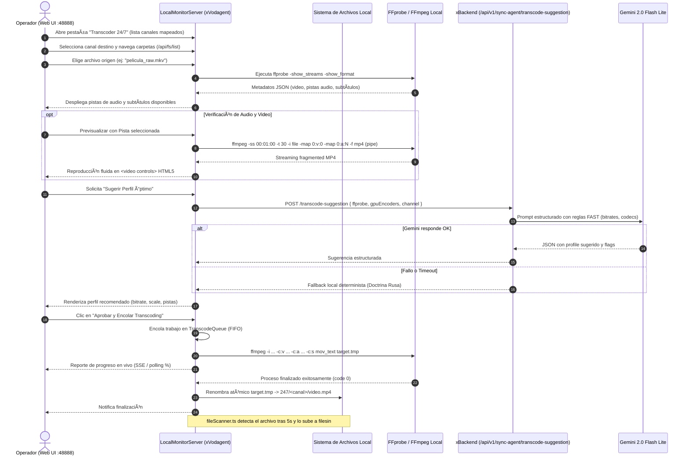

# REQ-2026-008: Estación de Transcoding Local Asistido y Sugerencia IA (xVodagent & xBackend)

| Metadato | Detalle |
| :--- | :--- |
| **ID Requerimiento:** | `REQ-2026-008` |
| **Sistema Destino:** | `Cross_System` (`xVodagent` / `xBackend`) |
| **Estado:** | `02_Aprobado` |
| **Fecha de Creación:** | 2026-10-23 |
| **Última Actualización:** | 2026-10-23 |
| **Autor(es):** | Lead Architect (Planning-X / Antigravity) |

---

## 1. Resumen Ejecutivo y Justificación de Negocio

En la Fase 1 (`REQ-2026-007`), se implementaron guardrails defensivos en `xVodagent` para bloquear subcarpetas desorganizadas y detener la subida de archivos ineficientes (bitrates excesivos, deficientes o 4K) reteniéndolos en estado `paused_efficiency`.

La **Fase 2** resuelve la necesidad del operador de convertir de manera ágil y asistida archivos multimedia heterogéneos (MKV, MP4, AVI, TS, archivos con múltiples pistas de idiomas o bitrates no conformes) directamente en su estación de trabajo antes de ser transferidos. 

Esta solución introduce:
1. Un **explorador de archivos local en la UI web** del monitor (`:48888`) que lista los canales 24/7 asignados al agente y permite seleccionar archivos en disco sin duplicar almacenamiento.
2. Un **inspector técnico FFprobe y reproductor integrado de audio y video en vivo** para previsualizar sincronizadamente imagen y pistas de audio en el navegador (validando de oído el idioma español, calidad visual y relación de aspecto) y preservar subtítulos.
3. Un **asistente de perfiles basado en Gemini 2.0 Flash Lite** en `xBackend` que analiza los metadatos y la aceleración de hardware detectada (NVIDIA NVENC, Intel QSV o CPU x264) para sugerir la línea de comandos FFmpeg óptima, con fallback determinista local si la nube no está disponible.
4. Una **cola secuencial mono-hilo (Worker FIFO)** en `xVodagent` que ejecuta la transcodificación en segundo plano y deposita atómicamente el `.mp4` en la carpeta del canal 24/7 (`<base>/247/<canal>/`), activando de forma transparente el escaneo, hashing y subida hacia `filesin`.

---

## 2. Filtro Doctrinal y Cuestionamiento Inicial (Engineering Rules)

### 2.1. Filtro Británico (*Keep it Plain* - Simplicidad Radical)
- **Cero Copia en UI:** Se descarta subir gigabytes por multipart/form-data a través del navegador. Dado que el servidor web corre en `127.0.0.1` en la misma máquina física que el operador, la UI utiliza un API de navegación de discos/carpetas (`/api/fs/*`) que manipula rutas directas del sistema de archivos local.
- **Worker FIFO Mono-Hilo:** Un solo proceso FFmpeg activo a la vez (`concurrency = 1`). Evita sobrecargar el hardware del operador o saturar memoria de video (VRAM) en tarjetas gráficas dedicadas.
- **Canal Directo hacia Playout:** El archivo resultante se escribe directamente en la carpeta asignada del canal (`247/<channel_folder>/`). No se inventa un pipeline intermedio nuevo: una vez generado el `.mp4` final, el escáner existente de Fase 1 toma el control automáticamente.

### 2.2. Filtro Alemán (*Gründlichkeit* - Rigor Estructural)
- **Contratos de Datos Rigurosos:**
  - `GET /api/transcode/channels`: Lista canales habilitados consultados a `xBackend`.
  - `POST /api/transcode/probe`: JSON exhaustivo de streams (video, audio, subtítulos).
  - `POST /api/v1/sync-agent/transcode-suggestion`: Contrato JSON con `xBackend` para la consulta a Gemini.
- **Escritura Atómica:** Durante la transcodificación, FFmpeg escribe sobre `<nombre>.transcoding.tmp`. Al terminar con exit code 0, se renombra atómicamente a `.mp4`. Esto garantiza que `fileScanner.ts` nunca intente leer un render en curso.
- **Preservación Obligatoria de Subtítulos:** Todos los streams de subtítulos se conservan mapeándolos mediante `-c:s mov_text` (o copy compatible) sin descartar información.

### 2.3. Filtro Ruso (*Nadezhnost* - Resiliencia L1/L2/L3)
- **L1 (Edge Cases):** Archivos sin pistas de audio, contenedores con nombres con caracteres especiales o espacios, pistas de audio sin tag de idioma, errores de timeout en FFmpeg, interrupción del servicio durante una transcodificación (limpieza de `.tmp`).
- **L2 (Integración):** Detección defensiva de aceleradores GPU (`ffmpeg -encoders`). Si `h264_nvenc` falla en tiempo de ejecución (ej. driver obsoleto), fallback suave a `libx264`.
- **L3 (Resiliencia Extrema / Fallback IA Offline):** Si `xBackend` o la API de Gemini fallan, presentan timeout o devuelven una respuesta malformada, el agente activa inmediatamente su **motor de perfil determinista local** aplicando los rangos exactos de `REQ-2026-007` sin bloquear al operador.

---

## 3. Alcance del Requerimiento

### 3.1. En Alcance (Fase 2)
- [x] **Detección de Aceleración de Hardware:** Detección en arranque de encoders FFmpeg instalados (`h264_nvenc`, `h264_qsv`, `libx264`), priorizando binarios en `xVodagent/bin/` con fallback a `PATH`.
- [x] **Navegador de Sistema de Archivos Local:** Endpoints en `LocalMonitorServer` para explorar discos y carpetas de la máquina del operador, filtrando archivos multimedia (`.mp4`, `.mkv`, `.avi`, `.ts`, `.mov`, `.m4v`, `.wmv`).
- [x] **Visualización de Canales 24/7 Asignados:** Espacio en la UI local que muestra los canales asignados al agente para seleccionar el destino del archivo.
- [x] **Inspector Técnico y Reproductor de Audio y Video en Vivo:**
  - Extracción de metadata con `ffprobe` en modo JSON.
  - Endpoint de streaming multimedia en vivo (`/api/transcode/media-preview`) para reproducir video fluido y la pista de audio seleccionada en el navegador (`<video controls>`), permitiendo verificar de oído el idioma español, calidad de imagen y relación de aspecto.
- [x] **Endpoint de Sugerencia Inteligente en `xBackend` (Gemini):**
  - Servicio en `xBackend/controllers/gemini.ts` que formula el prompt estructurado a `gemini-2.0-flash-lite`.
  - Fallback local determinista en `xVodagent` si la API no responde.
- [x] **Aprobación del Operador y Configuración:**
  - Pantalla modal donde el operador valida/edita las pistas de audio a incluir, confirma subtítulos, selecciona resolución y revisa el bitrate sugerido.
- [x] **Cola de Transcoding Secuencial (Worker FIFO):**
  - Manejo de estado (`queued`, `transcoding`, `completed`, `failed`).
  - Monitoreo en vivo de progreso (porcentaje, FPS, ETA).
  - Volcado final a `<monitoredBasePath>/247/<channel_folder>/` y disparo del ciclo normal de ingesta.

### 3.2. Fuera de Alcance
- Transcodificación masiva concurrente (se mantiene estricto `concurrency = 1` para proteger la máquina del operador).
- Edición o corte de video (timeline, trimming, filtros de color).
- Ingesta directa a VOD `/movies` o `/series` (acotado a canales 24/7 en esta fase).

---

## 4. Topología y Flujo de Datos Arquitectónico



---

## 5. Especificaciones Técnicas y Contratos de Datos

### 5.1. Detección de Aceleración Hardware (`hardwareDetector.ts`)
Al inicializarse, `xVodagent` ejecuta:
```bash
ffmpeg -encoders
```
Verifica la presencia de:
- `h264_nvenc`: NVIDIA GPU Hardware Acceleration.
- `h264_qsv`: Intel Quick Sync Video.
- Fallback: `libx264` (CPU Software Encoding).

El binario de FFmpeg se resuelve con la siguiente precedencia:
1. `<monitoredBasePath>/../bin/ffmpeg.exe` (o carpeta de instalación `xVodagent/bin/`).
2. Variable de entorno `FFMPEG_PATH`.
3. Búsqueda en el `PATH` del sistema.

### 5.2. Explorador de Archivos Local (`fsExplorer.ts`)
Endpoints expuestos en `LocalMonitorServer`:
- `GET /api/fs/drives`:
  - En Windows devuelve: `["C:\\", "D:\\", "E:\\"]`.
  - En Linux devuelve: `["/"]`.
- `GET /api/fs/list?dir=<path>`:
  - Lista subcarpetas y archivos con extensiones permitidas: `['.mp4', '.mkv', '.avi', '.ts', '.mov', '.m4v', '.wmv']`.
  - Retorna para cada elemento: `{ name, isDirectory, sizeBytes, modifiedAt, fullPath }`.

### 5.3. Reproductor y Previsualización de Audio y Video en Vivo (`mediaPreviewStreamer.ts`)
Endpoint en `LocalMonitorServer`:
- `GET /api/transcode/media-preview?file=<encodeURIComponent(path)>&audioIndex=<n>&startTime=<sec>`
- Emite un fragmento de video de vista previa (30 a 60 segundos) sincronizado con la pista de audio elegida:
  - Para contenedores heterogéneos (MKV, TS, AVI, HEVC/DTS), ejecuta FFmpeg en modo ultra-rápido generando un stream MP4 fragmentado al vuelo:
  ```bash
  ffmpeg -nostdin -ss <startTime> -t 30 -i "<filePath>" \
    -map 0:v:0 -map 0:<audioStreamIndex> \
    -c:v libx264 -preset ultrafast -s 640x360 -b:v 800k \
    -c:a aac -b:a 128k -ac 2 \
    -f mp4 -movflags frag_keyframe+empty_moov+default_base_moof pipe:1
  ```
- Devuelve cabeceras HTTP `Content-Type: video/mp4` con `Transfer-Encoding: chunked`.
- Permite que el elemento `<video controls autoplay>` en la UI web renderice el video fluido junto con el audio seleccionado, verificando de forma inmediata tanto el audio en español como el encuadre y sincronía visual.

### 5.4. Sugerencia de Perfil con Gemini en `xBackend`
- **Ruta:** `POST /api/v1/sync-agent/transcode-suggestion`
- **Controlador:** `xBackend/controllers/gemini.ts` -> `suggestTranscodeProfile`
- **Payload de Entrada:**
  ```json
  {
    "channelId": "120",
    "channelPath": "retro_cinema_247",
    "availableEncoders": ["h264_nvenc", "libx264"],
    "sourceMetadata": {
      "format": { "duration": 5420.5, "bit_rate": 8500000, "size": 5759283200 },
      "video": { "codec": "hevc", "width": 3840, "height": 2160, "fps": 23.976 },
      "audioTracks": [
        { "index": 1, "codec": "dts", "language": "eng", "channels": 6, "title": "English 5.1" },
        { "index": 2, "codec": "ac3", "language": "spa", "channels": 2, "title": "Español Latino" }
      ],
      "subtitles": [
        { "index": 3, "codec": "subrip", "language": "spa", "title": "Español Completos" }
      ]
    }
  }
  ```
- **Prompt a Gemini (`gemini-2.0-flash-lite`):**
  Se instruye al modelo a responder **únicamente un JSON** aplicando las reglas oficiales de `REQ-2026-007`:
  - Si la fuente es 4K (> 1080p), forzar escala a 1080p (`scale=1920:1080:force_original_aspect_ratio=decrease`).
  - Bitrate objetivo para 1080p: 3500 kbps (maxrate: 4200k, bufsize: 7000k).
  - Bitrate objetivo para 720p: 2200 kbps (maxrate: 2600k, bufsize: 4400k).
  - Codec de video: Seleccionar el mejor encoder disponible en `availableEncoders` (`h264_nvenc` > `h264_qsv` > `libx264`).
  - Mapeo de pistas: Recomendar pre-selección de pistas en español si existen, convertir audio a AAC estéreo 192k a 48kHz.
  - Subtítulos: Conservar pistas con `-c:s mov_text`.
- **Respuesta Estructurada:**
  ```json
  {
    "recommendedEncoder": "h264_nvenc",
    "scale": "1920:-2",
    "videoBitrate": "3500k",
    "maxRate": "4200k",
    "bufSize": "7000k",
    "preset": "p4",
    "audioBitrate": "192k",
    "audioSampleRate": 48000,
    "suggestedAudioTracks": [2],
    "preserveSubtitles": true,
    "ffmpegArguments": [
      "-c:v", "h264_nvenc",
      "-b:v", "3500k",
      "-maxrate", "4200k",
      "-bufsize", "7000k",
      "-vf", "scale=1920:-2",
      "-c:a", "aac",
      "-b:a", "192k",
      "-ac", "2",
      "-ar", "48000",
      "-c:s", "mov_text",
      "-movflags", "+faststart"
    ],
    "explanation": "Video 4K escalado a 1080p con bitrate eficiente de 3.5 Mbps usando aceleración NVIDIA NVENC. Se pre-selecciona la pista 2 (Español Latino) convertida a AAC estéreo y se preservan subtítulos."
  }
  ```
- **Fallback Determinista:** Si la llamada a Gemini excede 4 segundos o falla, `xVodagent` genera esta misma estructura mediante `profileEngine.ts` aplicando las constantes predefinidas.

### 5.5. Cola Secuencial (Worker FIFO) y Ejecución Atómica
- Implementación en `transcodeWorker.ts`.
- Mantiene una cola en memoria (`jobs: TranscodeJob[]`).
- Solo 1 trabajo en estado `running`.
- Monitoreo en tiempo real mediante `-progress pipe:1` para emitir eventos de progreso a la UI (`percentage`, `fps`, `out_time`, `speed`).
- Nomenclatura del archivo de destino:
  - Ruta: `<monitoredBasePath>/247/<channel_folder>/`
  - Nombre normalizado: POSIX limpio (ej. `los_simpson_s04e12.mp4`).
  - Archivo temporal: `los_simpson_s04e12.mp4.transcoding.tmp`.
  - Al completar: `fs.renameSync(tempPath, finalPath)`.

---

## 6. Plan de Implementación y Tareas Atómicas (<30 min)

### 6.1. Backend (`xBackend`)
- [ ] **Tarea 1.1:** Implementar `suggestTranscodeProfile` en `controllers/gemini.ts` con llamada a `gemini-2.0-flash-lite`, parseo defensivo de JSON y validación de esquema.
  - *Hecho cuando:* `POST /api/v1/sync-agent/transcode-suggestion` responda en <2s con JSON tipado y argumentos válidos de FFmpeg.
- [ ] **Tarea 1.2:** Registrar ruta en `server/routes.ts` con autenticación por token de agente.
  - *Hecho cuando:* Peticiones no autenticadas devuelvan 401 y agentes autorizados obtengan respuesta 200.

### 6.2. Agente Local (`xVodagent`)
- [ ] **Tarea 2.1:** Crear `hardwareDetector.ts` para chequear binarios de `ffmpeg`/`ffprobe` e identificar encoders GPU (`h264_nvenc`, `h264_qsv`, `libx264`).
  - *Hecho cuando:* Al arrancar el servicio imprima en log los codificadores detectados en la máquina.
- [ ] **Tarea 2.2:** Crear `fsExplorer.ts` con endpoints `/api/fs/drives` y `/api/fs/list` para navegar el sistema de archivos local de forma segura.
  - *Hecho cuando:* Al navegar desde la web se listen directorios y archivos de video sin fugas de memoria.
- [ ] **Tarea 2.3:** Crear `mediaInspector.ts` con extracción de streams vía `ffprobe` y endpoint `/api/transcode/probe`.
  - *Hecho cuando:* Devuelva el desglose exacto de streams de video, pistas de audio con idiomas y subtítulos.
- [ ] **Tarea 2.4:** Crear endpoint `/api/transcode/media-preview` en `localMonitorServer.ts` con tubería streaming MP4 fragmentado hacia `<video controls>`.
  - *Hecho cuando:* El navegador reproduzca de inmediato un fragmento de video fluido con la pista de audio seleccionada.
- [ ] **Tarea 2.5:** Crear `profileEngine.ts` con integración al endpoint de Gemini en `xBackend` y fallback local determinista.
  - *Hecho cuando:* Desconectando internet el generador devuelva un perfil válido cumpliendo los bitrates de `REQ-2026-007`.
- [ ] **Tarea 2.6:** Implementar `transcodeWorker.ts` (Cola FIFO, ejecución FFmpeg con `-progress pipe:1`, escritura `.tmp` y renombrado atómico).
  - *Hecho cuando:* Transcodifique un video de prueba a 1080p depositándolo en `247/<canal>/video.mp4` y limpiando archivos temporales.
- [ ] **Tarea 2.7:** Desarrollar interfaz visual en `localMonitorServer.ts` (Pestaña "Transcoder 24/7", selector de canales, explorador de carpetas, reproductor integrado de audio y video, configuración de perfil y barra de progreso de la cola).
  - *Hecho cuando:* El operador complete el flujo completo (seleccionar -> ver video / escuchar audio -> sugerir perfil -> transcodificar) desde `http://127.0.0.1:48888`.

---

## 7. Criterios de Aceptación y Matriz de Pruebas L1/L2/L3

| ID | Nivel | Escenario | Resultado Esperado |
| :--- | :--- | :--- | :--- |
| **TEST-01** | L1 | Archivo MKV con 3 pistas de audio (Inglés, Español, Comentarios) | El inspector muestra las 3 pistas. Al hacer clic en previsualizar pista 2, el reproductor web `<video>` reproduce el video sincronizado con el audio en español. |
| **TEST-02** | L1 | Video con subtítulos en formato SRT incrustados | El transcodificador genera el MP4 preservando subtítulos con formato compatible (`mov_text`). |
| **TEST-03** | L1 | Video 4K de 12 Mbps seleccionado para un canal 24/7 | Gemini (o fallback) sugiere escalar a 1080p con bitrate de 3.5 Mbps. |
| **TEST-04** | L2 | Máquina con tarjeta NVIDIA RTX/GTX | `hardwareDetector` detecta `h264_nvenc` y lo prioriza en la transcodificación con aceleración GPU. |
| **TEST-05** | L2 | Máquina sin GPU dedicada (CPU básica) | Detección limpia con fallback automático a `libx264`. |
| **TEST-06** | L3 | Caída de conexión a internet o falla en `xBackend` al solicitar perfil | `profileEngine.ts` activa el fallback determinista local de inmediato sin arrojar error al operador. |
| **TEST-07** | L3 | Operador cancela el trabajo de transcodificación en curso o se apaga el agente | El proceso FFmpeg es terminado y el archivo temporal `.transcoding.tmp` se elimina sin dejar residuos corruptos. |
| **TEST-08** | L3 | Finalización exitosa de transcodificación en la carpeta del canal | El archivo `.mp4` es detectado por `fileScanner.ts`, supera la validación de eficiencia de Fase 1 y se transfiere a `filesin`. |

