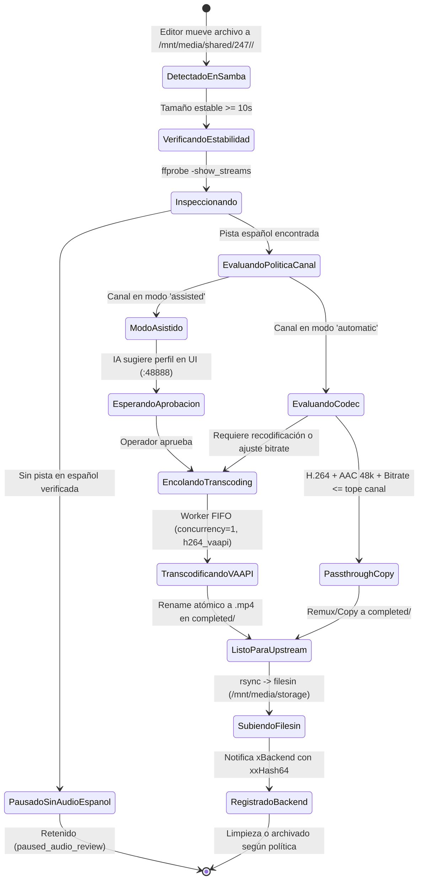

# REQ-2026-009: Transformación de xVodagent a Servicio Linux Dedicado con Samba y Aceleración GPU Intel VA-API

| Metadato | Detalle |
| :--- | :--- |
| **ID Requerimiento:** | `REQ-2026-009` |
| **Sistema Destino:** | `Cross_System` (`xVodagent` / `xBackend`) |
| **Estado:** | `02_Aprobado` |
| **Severidad / Prioridad:** | Alta / Arquitectónica |
| **Fecha de Creación:** | 2026-11-11 |
| **Última Actualización:** | 2026-11-11 |
| **Autor(es):** | Lead Architect (Planning-X / Antigravity) |
| **Motor de Programación:** | **Claude Code** |

---

## 1. Resumen Ejecutivo y Cambio de Paradigma

El modelo original de `xVodagent` como agente individual ejecutado en las computadoras de escritorio de los editores/operadores presentó limitaciones de escalabilidad:
- Alto consumo de CPU/GPU en estaciones de trabajo interrumpiendo las tareas de edición.
- Dispersión y saturación de enlaces residenciales/locales de subida.
- Dificultades para garantizar drivers de GPU y entornos FFmpeg homogéneos.

Este requerimiento formaliza la **transformación arquitectónica de `xVodagent` en un Servicio Linux Centralizado (Appliance de Ingesta y Transcoding)** desplegado en el servidor dedicado en red local (`192.168.7.232`, Ubuntu 26.04.1 LTS, Intel Core i7-8700, 30 GiB RAM, GPU **Intel UHD Graphics 630** con aceleración verificada vía **VA-API `h264_vaapi`** en `/dev/dri/renderD128`, volumen LVM dedicado de `356 GiB` montado en `/mnt/media`).

### Pilares del Nuevo Flujo:
1. **Ingesta Centralizada por Samba (SMB):** Los operadores depositan y recorren sus archivos multimedia exclusivamente en `/mnt/media/shared/247/<canal>/` (expuesto por Samba como `\\192.168.7.232\xIPTV-Ingest\247\<canal>\` y en el explorador del Transcoder UI `:48888`), sin visibilidad de carpetas internas (`raw`, `processing`, `completed`, `failed`, `archive`).
2. **Control Anti-Archivos Incompletos:** Detección de finalización de copia mediante invariabilidad de tamaño de archivo y eventos de cierre de escritura (`>= 10s`).
3. **Filtro Estricto de Audio Español:** Verificación obligatoria de pista en español (`spa`, `es`, `es-la`, `es-es`, `es-419`, `spanish`). Si un archivo no tiene audio en español identificado, se suspende el proceso de forma preventiva (`paused_audio_review`).
4. **Inspección de Compatibilidad Dual (ISDB-T + VOD) y Passthrough:** Si el archivo ya es H.264 + AAC 48.000 Hz estéreo y su bitrate está dentro del rango del canal, se aplica **Stream Copy** (cero tiempo y cero carga GPU). Si no cumple, se transcodifica por hardware con **`h264_vaapi`** (`/dev/dri/renderD128`), con soporte multi-backend (`h264_vaapi` / `h264_nvenc` / `h264_qsv` / fallback `libx264`).
5. **Modo Automático / Asistido por Canal 24/7:** Perfiles de compresión diferenciados según el contenido del canal (ej: mayor bandwidth para acción, menor bandwidth para animación infantil).
6. **Worker Mono-Hilo (`concurrency = 1`):** Ejecución secuencial FIFO en GPU para máxima estabilidad operativa.
7. **Upstream Asíncrono:** Transferencia controlada del material final hacia el servidor `filesin` (`/mnt/media/storage`) vía `rsync`/SSH con registro de metadata y hashes en `xBackend`.

---

## 2. Marco Doctrinal de Ingeniería (Engineering Rules)

### 2.1. Filtro Británico (*Keep it Plain* - Simplicidad Radical)
- **Cero Interfaces Innecesarias en la Ingesta:** Los editores no requieren abrir aplicaciones web ni subir archivos mediante multipart/HTTP; simplemente arrastran los archivos a la carpeta del canal en su explorador de Windows habitual mediante el share de Samba.
- **Un Solo Proceso GPU a la Vez (`concurrency = 1`):** Evita saturar la iGPU/memoria compartida y mantiene predecible el tiempo de respuesta de la cola FIFO.
- **Reutilización de Módulos:** Se preservan y adaptan los componentes ya probados de `xVodagent`: `mediaInspector`, `hardwareDetector`, `transferManager`, `profileEngine`, `transcodeWorker` y `localMonitorServer`.

### 2.2. Filtro Alemán (*Gründlichkeit* - Rigor Estructural)
- **Estándar Estricto de Emisión ISDB-T / VOD:**
  - **Video:** H.264 / AVC, High o Main Profile, Level $\le 4.1$, Chroma `yuv420p` (`format=nv12,hwupload` para VA-API), GOP cerrado (Keyframe cada $\le 2$ segundos: `-g <fps*2> -keyint_min <fps*2> -sc_threshold 0`).
  - **Audio:** AAC-LC, exactamente **48.000 Hz** (exigencia técnica de moduladores ISDB-T), 2 canales (Stereo), bitrate 128k a 192k.
- **Escritura Transaccional Atómica:** FFmpeg codifica hacia `<archivo>.transcoding.tmp`. Al finalizar con exit code 0, se renombra atómicamente a `.mp4`. Nunca se exponen renders parciales al uploader.
- **Guardrail de Idioma:** En ningún caso se permite la subida desatendida de un archivo cuyo audio no sea validado en español.

### 2.3. Filtro Ruso (*Nadezhnost* - Resiliencia L1/L2/L3)
- **L1 (Edge Cases):** Archivos a medio escribir en Samba, desconexión del cliente Samba durante el copiado, nombres con caracteres especiales, archivos MKV con múltiples pistas de subtítulos complejos o audio 5.1/7.1 (downmixing a stereo 2.0).
- **L2 (Integración):** En Ubuntu 26.04 sobre Intel UHD 630, `h264_qsv` falla (`Error creating a MFX session: -9`), mientras que **`h264_vaapi`** sobre `/dev/dri/renderD128` funciona nativamente (`VAAPI_OK`). El detector de hardware debe priorizar y probar realmente `h264_vaapi` (vía `-vaapi_device`), cayendo suavemente a `libx264` si fallara en runtime.
- **L3 (Resiliencia de Red y Upstream):** Si el enlace a internet se interrumpe durante el upstream a `filesin`, `rsync` reanuda la transferencia sin reiniciar desde cero; el archivo local permanece en staging hasta confirmar el hash remoto.

---

## 3. Especificación Funcional Detallada

### 3.1. Estructura de Directorios en `/mnt/media` (Ya Desplegada)

```
/mnt/media/                              <-- Volumen LVM dedicado (356 GiB ext4)
├── shared/                              <-- ÚNICA vista del Operador (Samba [xIPTV-Ingest] y Transcoder UI)
│   └── 247/
│       └── <canal_247>/                 <-- Carpetas por canal (sin raw/archive/completed/unassigned visibles)
│           └── (archivo origen .mkv/.mp4/.avi/.ts)
└── ingest/                              <-- Carpetas INTERNAS del servicio (ocultas al operador)
    ├── processing/                      <-- Staging de transcodificación temporal
    ├── completed/                       <-- MP4 finales validados listos para upstream
    ├── failed/                          <-- Archivos con error o en paused_audio_review
    └── archive/                         <-- Respaldo de originales tras upstream exitoso
```

### 3.2. Ciclo de Vida del Archivo de Ingesta



### 3.3. Lógica de Selección de Audio (Mandatoria)
1. Se extraen los streams de audio con `ffprobe -show_streams -select_streams a`.
2. Para cada stream se evalúa:
   - Tag `language` / `lang`: valores válidos `spa`, `es`, `es-la`, `es-es`, `es-419`, `spanish`.
   - Tag `title`: palabras clave `latino`, `español`, `spanish`, `castellano`.
3. Si existe una pista coincidente:
   - Se mapea dicha pista (`-map 0:a:<index>`), con `-ac 2` y `-ar 48000`.
4. Si **NO** se encuentra pista en español:
   - Estado **`paused_audio_review`** (no transcodifica ni sube).
   - Se expone en la Web UI (`:48888`) y en el heartbeat a `xBackend` para que el operador elija manualmente la pista correcta si el contenedor venía sin etiquetas de idioma.

### 3.4. Políticas de Perfil de Compresión por Canal 24/7

| Categoría | Clave | Encoder Target | Bitrate Target Video | Audio Target | Modo por Defecto |
| :--- | :--- | :--- | :--- | :--- | :--- |
| **Infantiles** | `kids` | `h264_vaapi` (`renderD128`) | **800 Kbps** (`800k`, max `960k`, buf `1600k`) | AAC 48kHz 128k stereo | Automático |
| **General** | `general` | `h264_vaapi` / Sugerido IA | **1.8 Mbps** (`1800k`, max `2160k`, buf `3600k`) | AAC 48kHz 160k stereo | Asistido |
| **Acción** | `action` | `h264_vaapi` (`renderD128`) | **2.5 Mbps** (`2500k`, max `3000k`, buf `5000k`) | AAC 48kHz 192k stereo | Automático |
| **Ultra** | `ultra` | `h264_vaapi` (`renderD128`) | **3.5 Mbps** (`3500k`, max `4200k`, buf `7000k`) | AAC 48kHz 192k stereo | Automático |

---

## 4. Infraestructura Desplegada en `192.168.7.232` (Verificada)

| Componente | Estado | Detalle Verificado |
| :--- | :--- | :--- |
| **SO & Kernel** | Operativo | Ubuntu 26.04.1 LTS (`resolute`), Kernel `7.0.0-43-generic x86_64` |
| **CPU & RAM** | Operativo | Intel Core i7-8700 (12 hilos), 30 GiB RAM |
| **GPU Activa** | Operativo (`VAAPI_OK`) | Intel UHD Graphics 630 (`/dev/dri/renderD128`), Intel iHD driver `26.1.2` |
| **Almacenamiento** | Montado (`/etc/fstab`) | LVM `ubuntu-vg/media-lv` (`356 GiB` ext4) -> `/mnt/media` |
| **Samba Share** | Activo (`smbd`) | `[xIPTV-Ingest]` -> `/mnt/media/shared` (permisos `0777`, solo `247/<canal>/`) |
| **Runtime & Binarios** | Instalado | Node.js `v22.22.1`, npm `9.2.0`, FFmpeg `8.0.1`, rsync `3.4.1` |
| **Directorio App** | Creado | `/opt/xvodagent` (owner `ubuntu:ubuntu`) |
| **Systemd Unit** | Habilitado (`enabled`) | `/etc/systemd/system/xvodagent.service` (`ExecStart=/usr/bin/node /opt/xvodagent/dist/vodagent.js`, user `ubuntu`, grupos `video, render`, env `VAAPI_DEVICE=/dev/dri/renderD128`) |

---

## 5. Matriz de Pruebas Defensivas (Filtro Ruso)

### 5.1. Nivel L1 (Edge Cases y Resiliencia de Entrada)
- [ ] Archivo copiado por Samba con tamaño creciente: no procesar hasta invariabilidad $\ge 10$ s.
- [ ] Archivo sin pista español (`eng` o sin tag): pasa a `paused_audio_review` y no se transcodifica ni sube.
- [ ] Audio 5.1/7.1 downmix a estéreo 48.000 Hz sin errores de filtro.

### 5.2. Nivel L2 (Integración y Aceleración Intel VA-API)
- [ ] `npx tsc --noEmit` con código de salida `0`.
- [ ] `hardwareDetector.ts` detecta y valida `h264_vaapi` en `/dev/dri/renderD128` con prueba sintética real.
- [ ] `transcodeWorker.ts` ejecuta FFmpeg VA-API con `-vaapi_device /dev/dri/renderD128 -vf format=nv12,hwupload -c:v h264_vaapi` (y escalado `scale_vaapi` si excede 1080p), generando `.mp4` compatible ISDB-T y VOD.
- [ ] Archivo que ya cumple H.264 + AAC 48kHz + bitrate OK se copia/remuxa sin invocar re-encode.

### 5.3. Nivel L3 (Estrés y Caída de Conectividad)
- [ ] Corte de red WAN durante `rsync` hacia `filesin`: reanudación automática sin pérdida de archivo local.
- [ ] Concurrencia `1` estricta bajo múltiples archivos simultáneos en `/mnt/media/shared/247/*`.

---

## 6. Criterios de Aceptación (Definition of Done)

1. [ ] Refactor implementado exclusivamente por **Claude Code** en `D:\Projects\DEV\xIPTV\xVodagent`.
2. [ ] `npx tsc --noEmit` y `npm run build` pasan con 0 errores.
3. [ ] Despliegue en `192.168.7.232:/opt/xvodagent` corriendo bajo `systemctl start xvodagent` sin errores.
4. [ ] Prueba end-to-end exitosa: copiar un `.mkv` por Samba $\to$ detección automática $\to$ transcode `h264_vaapi` (audio español 48kHz) $\to$ upstream por `rsync` a `filesin`.
