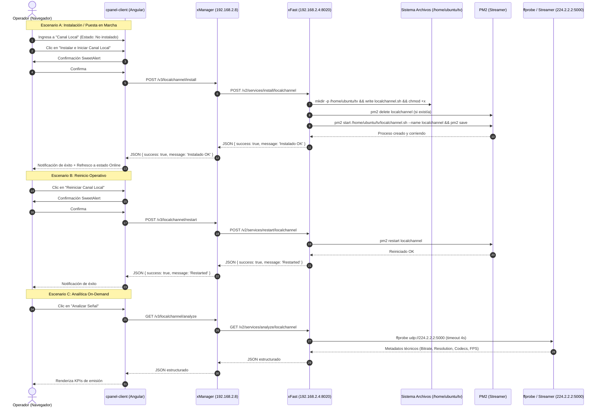

# Documento de Especificación Técnica: Instalación, Control y Analítica On-Demand del Canal Local en Streamer (xFast + xManager + cPanel)

| Metadato | Detalle |
| :--- | :--- |
| **ID Requerimiento:** | `REQ-2026-010` |
| **Sistema Destino:** | `Cross_System` (`xFast`, `xManager`, `cpanel-client`) |
| **Estado:** | `02_Aprobado` |
| **Fecha de Creación:** | 2026-11-11 |
| **Última Actualización:** | 2026-11-11 (implementación Fases 1–3) |
| **Autor(es):** | Lead Architect (Gemini / Planning-X) |
| **Motor de Programación:** | Claude Code |

---

## 1. Resumen Ejecutivo y Justificación de Negocio

En los nodos de transmisión del ecosistema xIPTV, opera un canal local independiente gestionado bajo el gestor de procesos **PM2** con el nombre de servicio **`localchannel`**, el cual corresponde a un pipeline de FFmpeg ejecutado desde un script bash ubicado en `/home/ubuntu/tv/localchannel.sh` que procesa una fuente RTMP entrante y emite un stream multicast continuo en el socket **`udp://224.2.2.2:5000`**.

Actualmente, el despliegue del script y su puesta en marcha en PM2 se realiza de forma manual en cada streamer, y cuando el stream RTMP sufre interrupciones o microcortes, el operador no cuenta con una interfaz web en el panel para intervenir el servicio en el streamer remoto ni para diagnosticar su salud técnica.

El presente requerimiento define la arquitectura integral para:
1. **Instalación y Despliegue Automático:** Capacidad de aprovisionar el script `/home/ubuntu/tv/localchannel.sh` en el streamer y registrar/lanzar el servicio en **PM2** mediante un solo clic desde el panel de control.
2. **Control Remoto de Ciclo de Vida (PM2):** Permitir al operador reiniciar o reinstalar el servicio `localchannel` de forma segura desde el panel web.
3. **Telemetría de Proceso (PM2):** Consultar en tiempo real el estado del proceso (`online`/`stopped`/`not_installed`), tiempo activo (`uptime`), contador de reinicios (`restarts`), consumo de CPU y memoria RAM.
4. **Analítica de Señal On-Demand (Stream Probe):** Realizar un análisis técnico en vivo bajo demanda (*on request*) de la señal transmitida en `udp://224.2.2.2:5000` mediante `ffprobe` en el streamer, obteniendo bitrate, resolución, codecs de audio/video y fps.
5. **Puente de Comunicación Ultraliviano (xFast):** Reutilizar el servicio `xFast` ya desplegado en el streamer (`192.168.2.4:8020`) y referenciado en `xManager` (`fastwebserver`), eliminando la necesidad de túneles SSH, llaves de acceso o demonios adicionales.
6. **Interfaz de Operación Centralizada (`cpanel-client`):** Crear un módulo y pestaña dedicada de primer nivel denominada **"Canal Local"** con controles protegidos, asistente de instalación y paneles visuales de analítica.

---

## 2. Definición del Script de Emisión (`localchannel.sh`)

El archivo base de emisión en el streamer se ubica en:
📁 `/home/ubuntu/tv/localchannel.sh`

### Contenido Canónico del Script:
```bash
#!/bin/bash

# rtmp://192.168.100.5:1935/live/stream

ffmpeg -re -listen 1 -i rtmp://0.0.0.0:1935/live/stream -c:v copy -c:a aac -b:a 64k -ac 2 -f mpegts -mpegts_service_id 0x1001 -mpegts_pmt_start_pid 0x1002 -mpegts_flags latm -metadata service_name="Canal Local" -metadata service_provider="XI" "udp://224.2.2.2:5000/?pkt_size=1316&buffer_size=5000000&localaddr=192.168.3.4"
```

### Reglas de Ejecución del Script:
- Permisos del archivo: `chmod +x /home/ubuntu/tv/localchannel.sh` (o `0755`).
- Comando de inicio PM2: `pm2 start /home/ubuntu/tv/localchannel.sh --name localchannel`
- Persistencia PM2: `pm2 save`

---

## 3. Filtro Doctrinal y Cuestionamiento Inicial

### 3.1. Filtro Británico (*Keep it Plain* - Simplicidad Radical)
- **Descarte de SSH / Ansible:** Desplegar el script directamente a través de `xFast` mediante llamadas HTTP autenticadas y locales evita la necesidad de credenciales SSH o túneles VPN entre `xManager` y el streamer.
- **Sin complejidad de base de datos:** El canal local funciona mediante un script `.sh` estático. No se crean tablas nuevas en PostgreSQL ni se ensucia el catálogo de canales live.
- **Doctrina No-Astra en UI:** En la interfaz de usuario se utilizan exclusivamente nombres operativos neutros ("Canal Local", "Servidor de Transmisión", "Proceso de Emisión Local").

### 3.2. Filtro Alemán (*Gründlichkeit* - Rigor Estructural)
- **Contratos de Datos Rigurosos:** Todo intercambio HTTP (`xManager <-> xFast` y `cpanel-client <-> xManager`) implementa contratos JSON estrictos y tipados en TypeScript.
- **Seguridad y Prevención de Inyección (Whitelist):** Los endpoints de gestión de procesos en `xFast` no permiten nombres de proceso ni rutas arbitrarias; operan exclusivamente sobre `localchannel` y la ruta `/home/ubuntu/tv/localchannel.sh`.
- **Límites de Ejecución (Timeouts Defensivos):** Las invocaciones a `ffprobe` poseen un timeout estricto de 4 segundos para evitar bloquear el event loop de Node.js si la fuente RTMP no emite paquetes.

### 3.3. Filtro Ruso (*Nadezhnost* - Resiliencia y Matriz L1/L2/L3)
- **L1 (Edge Cases):**
  - Si el directorio `/home/ubuntu/tv` no existe, crearlo recursivamente (`mkdir -p`).
  - Si el proceso en PM2 ya existe al momento de instalar, eliminarlo previamente (`pm2 delete localchannel`) antes de relanzarlo para evitar colisiones de PID o duplicación de procesos.
  - Si no hay señal en `udp://224.2.2.2:5000`, `ffprobe` finaliza por timeout y reporta `{ online: false, message: 'Señal multicast inactiva o sin flujo de paquetes' }`.
- **L2 (Integración):**
  - Compilación estricta en TypeScript (`npx tsc --noEmit`) en `xFast` y `xManager`.
  - Enrutamiento y control de permisos en `cpanel-client` respetando roles y directivas de diseño UI.
- **L3 (Resiliencia y Concurrencia):**
  - Cerrojo en `xFast` (*busy flag*) durante la instalación o reinicio para evitar que clics reiterados disparen múltiples ejecuciones simultáneas de PM2.
  - Si el streamer (`fastwebserver`) no está accesible, `xManager` captura el timeout de red y responde con HTTP 502/504 con mensaje claro para la interfaz.

---

## 4. Alcance y Límites del Requerimiento

### 4.1. En Alcance (In Scope)
- **En `xFast`:**
  - Endpoint `POST /v2/services/install/localchannel`: Crea `/home/ubuntu/tv/localchannel.sh`, asigna permisos ejecutables, lanza `pm2 start` y ejecuta `pm2 save`.
  - Endpoint `POST /v2/services/restart/:service`: Reinicia el servicio `localchannel` en PM2 con cerrojo de concurrencia.
  - Endpoint `GET /v2/services/status/:service`: Inspección de PM2: estado (`online`/`stopped`/`not_installed`), uptime, restarts, CPU, RAM.
  - Endpoint `GET /v2/services/analyze/localchannel`: Sondeo on-demand vía `ffprobe` del socket `udp://224.2.2.2:5000`.
- **En `xManager`:**
  - Controlador `src/controllers/localchannel.ts` que resuelve la URL del streamer desde `Server.params.get('fastwebserver')`.
  - Rutas en `src/server/routercpanel.ts`:
    - `POST /v3/localchannel/install`
    - `POST /v3/localchannel/restart`
    - `GET /v3/localchannel/status`
    - `GET /v3/localchannel/analyze`
- **En `cpanel-client`:**
  - Nuevo módulo y componente `LocalChannelModule` / `LocalChannelComponent`.
  - Elemento de primer nivel en la barra de navegación lateral: **"Canal Local"** con icono `fas fa-broadcast-tower` (registrado en `_nav.ts` y condicionado a `options.menu.includes('localchannel')`).
  - Tarjeta de Instalación / Estado Operativo (PM2): Detección de "No Instalado" con botón "Instalar e Iniciar Canal Local", métricas en vivo (Uptime, Restarts, CPU, RAM) y botón "Reiniciar Canal Local" (con modal SweetAlert).
  - Tarjeta de Analítica On-Demand: Botón "Analizar Señal", indicadores de Estado (En Línea / Sin Señal), Bitrate, Resolución, FPS, Codec Video, Codec Audio, y visor de streams técnicos.
- **En `xBackend` / `xServerSQL` / `cpanel-admin`:**
  - Registro de `localchannel` en la tabla `tenant_menus` y procedimiento `tenantmeta.sql`.
  - Depuración y eliminación de los menús exclusivos de `cpanel-admin` de la lista de `tenant_menus` (`kanban`, `syncagents`, `upcomingmovies`, `uploads`, `users`, `tenants`). Se conservan `movies`, `videos` y `monitoring` porque `cpanel-client` también los usa (decisión R2, 2026-11-11).
  - Actualización del catálogo `availableMenus` en `cpanel-admin` (`tenants.component.ts` y `tenants.service.ts`).

### 4.2. Fuera de Alcance (Out of Scope - *YAGNI*)
- Modificar el binario de FFmpeg en el sistema operativo del streamer.
- Monitoreo continuo o cron en segundo plano guardando series temporales en InfluxDB (el análisis de video/audio es estrictamente *on demand*).
- Compilación o despliegue del frontend desde el entorno local (`ng build`, `npm run build` y empaquetado prohibidos por directiva).

---

## 5. Arquitectura y Flujo de Comunicación



---

## 6. Contratos de Datos y Especificaciones de Endpoints

### 6.1. Endpoints de `xFast` (Streamer - Puerto 8020)

#### 6.1.1. `POST /v2/services/install/localchannel`
- **Operaciones:**
  1. Asegurar existencia de `/home/ubuntu/tv`.
  2. Escribir `/home/ubuntu/tv/localchannel.sh` con el contenido canónico.
  3. `chmod +x /home/ubuntu/tv/localchannel.sh`.
  4. Ejecutar comando PM2:
     ```bash
     pm2 delete localchannel 2>/dev/null || true; pm2 start /home/ubuntu/tv/localchannel.sh --name localchannel && pm2 save
     ```
- **Respuesta Exitosa (200 OK):**
```json
{
  "success": true,
  "service": "localchannel",
  "action": "install",
  "script_path": "/home/ubuntu/tv/localchannel.sh",
  "message": "Script instalado y servicio localchannel iniciado exitosamente en PM2."
}
```
- **Respuesta de Error (500 Internal Server Error):**
```json
{
  "success": false,
  "service": "localchannel",
  "error": "Error al aprovisionar script o lanzar PM2: <detalle>"
}
```

#### 6.1.2. `POST /v2/services/restart/:service`
- **Validación:** `:service` DEBE ser estrictamente `'localchannel'`.
- **Ejecución:** `pm2 restart localchannel` (con cerrojo para evitar solapamientos durante 5s).
- **Respuesta Exitosa (200 OK):**
```json
{
  "success": true,
  "service": "localchannel",
  "action": "restart",
  "timestamp": "2026-11-11T12:00:00.000Z",
  "message": "Servicio localchannel reiniciado exitosamente."
}
```

#### 6.1.3. `GET /v2/services/status/:service`
- **Validación:** `:service` DEBE ser `'localchannel'`.
- **Ejecución:** Consulta a PM2 (`pm2 jlist`).
- **Respuesta Proceso Existente (200 OK):**
```json
{
  "success": true,
  "service": "localchannel",
  "installed": true,
  "data": {
    "status": "online",
    "pid": 14285,
    "uptime_seconds": 86420,
    "restarts": 3,
    "cpu_percent": 12.4,
    "memory_bytes": 145227776,
    "memory_formatted": "138.5 MB",
    "pm_id": 0
  }
}
```
- **Respuesta Proceso No Encontrado (200 OK):**
```json
{
  "success": true,
  "service": "localchannel",
  "installed": false,
  "message": "El servicio localchannel no está registrado en PM2."
}
```

#### 6.1.4. `GET /v2/services/analyze/localchannel`
- **Socket:** `udp://224.2.2.2:5000`
- **Ejecución:** 
  `ffprobe -v quiet -print_format json -show_format -show_streams -analyzeduration 3000000 -probesize 3000000 "udp://224.2.2.2:5000?timeout=4000000"` (timeout global de proceso: 5 segundos).
- **Respuesta Señal Activa (200 OK):**
```json
{
  "success": true,
  "online": true,
  "socket": "udp://224.2.2.2:5000",
  "timestamp": "2026-11-11T12:00:00.000Z",
  "summary": {
    "bitrate_kbps": 4250,
    "bitrate_mbps": "4.25",
    "video": {
      "codec": "h264",
      "profile": "High",
      "width": 1920,
      "height": 1080,
      "resolution": "1920x1080",
      "fps": "30/1",
      "pix_fmt": "yuv420p"
    },
    "audio": {
      "codec": "aac",
      "channels": 2,
      "sample_rate": "48000",
      "bitrate_kbps": 128
    },
    "container": "mpegts"
  },
  "raw_streams_count": 2
}
```
- **Respuesta Señal Inactiva / Timeout (200 OK):**
```json
{
  "success": true,
  "online": false,
  "socket": "udp://224.2.2.2:5000",
  "timestamp": "2026-11-11T12:00:00.000Z",
  "message": "No se detecta flujo de paquetes en el socket multicast (señal caída o detenida)."
}
```

---

### 6.2. Endpoints de `xManager` (Backend - Puerto 80 / Router cPanel)

- Rutas en `routercpanel.ts`:
  - `POST /v3/localchannel/install`
  - `POST /v3/localchannel/restart`
  - `GET /v3/localchannel/status`
  - `GET /v3/localchannel/analyze`
- **Mapeo de Red:**
  `fastwebserver` se lee de `Server.params.get('fastwebserver')`.
- **Manejo de Errores:** Errores de red (`ECONNREFUSED`, `ETIMEDOUT`) contra `fastwebserver` se capturan y devuelven como JSON 502/504 comprensibles para la interfaz.

---

## 7. Especificación de Interfaz de Usuario (`cpanel-client`)

### 7.1. Navegación Lateral (Sidebar)
- Nuevo elemento de primer nivel:
  - **Etiqueta:** `Canal Local`
  - **Ruta:** `/localchannel`
  - **Ícono:** `fas fa-broadcast-tower`
  - **Permisos:** Roles de administración y soporte.

### 7.2. Vista Principal (`localchannel.component.html`)

1. **Estado No Instalado (Banner / Card Informativa):**
   - Si `installed === false`, la vista muestra una tarjeta destacada:
     - Título: *"Canal Local no configurado en este servidor"*
     - Descripción: *"El servicio localchannel no se encuentra registrado en el gestor de procesos del streamer. Presione el botón a continuación para desplegar el script e iniciar la transmisión."*
     - Botón de Acción Principal: `Instalar e Iniciar Canal Local` (`btn-success` con ícono `fas fa-download`).

2. **Tarjeta de Control Operativo y Proceso (PM2):**
   - Visible cuando `installed === true`.
   - **Badges de Estado:** `En Línea` (Verde) / `Detenido` (Rojo).
   - **Métricas:** Uptime (ej. "3 horas 24 min"), Contador de reinicios, CPU (%), Memoria RAM utilizada.
   - **Botón Principal:** `Reiniciar Canal Local` (`btn-warning`, icono `fas fa-sync-alt`). Abre modal SweetAlert advirtiendo breve pausa en la emisión.
   - **Botón Secundario:** `Reinstalar / Actualizar Script` (`btn-outline-secondary`, icono `fas fa-wrench`) para re-escribir el archivo `.sh` si se requiere regenerar la configuración.

3. **Tarjeta de Diagnóstico y Analítica On-Demand:**
   - **Botón:** `Analizar Señal en Vivo` (`btn-primary`, icono `fas fa-search`).
   - Spinner de carga mientras `ffprobe` analiza el socket multicast (2-4s).
   - **KPIs Visuales:**
     - Estado de Transmisión: `Señal Presente` (Verde) / `Sin Flujo de Paquetes` (Rojo).
     - Bitrate: e.g. `4.25 Mbps`.
     - Resolución de Video: e.g. `1920x1080 (Full HD)`.
     - FPS: e.g. `30 fps`.
     - Codecs: Video H.264 / Audio AAC 64 kbps (2 ch).
   - **Panel Desplegable:** Detalles técnicos del contenedor MPEG-TS y timestamp de la última toma de muestra.

---

## 8. Plan de Tareas Atómicas para Claude Code

Las tareas deben ser ejecutadas por **Claude Code** en cada repositorio:

### Fase 1: `xFast` (Repositorio `xFast`)
- [x] **Tarea 1.1:** Crear `controllers/servicemanager.ts` en `xFast`.
  - Método `installLocalChannel()`: `mkdir -p /home/ubuntu/tv`, escribir script canónico con permisos `0755`, y ejecutar `pm2 delete localchannel 2>/dev/null || true; pm2 start /home/ubuntu/tv/localchannel.sh --name localchannel && pm2 save`.
  - Método `restartService(serviceName: string)`: whitelist `['localchannel']` y cerrojo de concurrencia.
  - Método `getServiceStatus(serviceName: string)`: consulta `pm2 jlist` y extrae métricas o estado no instalado.
  - Método `analyzeMulticastStream()`: ejecuta `ffprobe` contra `udp://224.2.2.2:5000` con timeout de 4 segundos.
- [x] **Tarea 1.2:** Registrar rutas en `server/routerclient.ts`:
  - `POST /v2/services/install/localchannel`
  - `POST /v2/services/restart/:service`
  - `GET /v2/services/status/:service`
  - `GET /v2/services/analyze/localchannel`
- [x] **Tarea 1.3:** Verificación de compilación TypeScript (`npx tsc --noEmit`).

### Fase 2: `xManager` (Repositorio `xManager`)
- [x] **Tarea 2.1:** Crear controlador `src/controllers/localchannel.ts` con métodos `install`, `restart`, `status`, `analyze`, leyendo `fastwebserver` de `params`.
- [x] **Tarea 2.2:** Registrar rutas en `src/server/routercpanel.ts`:
  - `POST /v3/localchannel/install`
  - `POST /v3/localchannel/restart`
  - `GET /v3/localchannel/status`
  - `GET /v3/localchannel/analyze`
- [x] **Tarea 2.3:** Verificación de compilación TypeScript (`npx tsc --noEmit`).

### Fase 3: `cpanel-client` (Repositorio `cpanel-client`)
- [x] **Tarea 3.1:** Crear servicio Angular `LocalChannelService` (`localchannel.service.ts`).
- [x] **Tarea 3.2:** Crear componente `LocalChannelComponent` (HTML, TS, CSS) con el estado de instalación, tarjetas de control PM2 y analítica de señal.
- [x] **Tarea 3.3:** Configurar rutas en `app-routing.module.ts`.
- [x] **Tarea 3.4:** Incorporar ítem "Canal Local" en el menú de navegación lateral (`_nav.ts` con url `/localchannel` e icono `fas fa-broadcast-tower`).
- [x] **Tarea 3.5:** Verificación estricta: NO compilar (`ng build` prohibido); auditar únicamente sintaxis y tipado.

### Fase 4: Catálogo de Menús de Tenants (`xBackend` / `xServerSQL` / `cpanel-admin`)
- [x] **Tarea 4.1:** Crear migración SQL `0013_add_localchannel_menu_clean_admin_menus.sql` (renombrada desde `0012` por colisión con `0012_add_softcam_hosts.sql`) y actualizar `tenantmeta.sql` en `sql/xServerSQL/`.
- [x] **Tarea 4.2:** Actualizar catálogo `availableMenus` y fallback de `getTenantMeta()` en `cpanel-admin` (`tenants.component.ts` y `tenants.service.ts`), añadiendo `localchannel` y depurando los menús exclusivos del panel admin (`kanban`, `syncagents`, `monitoring`, `upcomingmovies`, `movies`, `videos`, `uploads`, `users`, `tenants`).
- [x] **Tarea 4.3:** Aplicar migración SQL `0013_add_localchannel_menu_clean_admin_menus.sql` en la base de datos `xserverdb` (100.64.0.42:5432) con respaldo previo de `tenant_menus`.
- [x] **Tarea 4.4:** Habilitar el menú `localchannel` en `options.menu` del tenant `server43` (Cliente 43) en `xserverdb`.
- [x] **Tarea 4.5:** Despliegue y certificación en vivo en Cliente 43 (`xManager` en 100.64.43.8 y `xFast` en 100.64.43.2:8222 / 192.168.2.4:8020) con `FASTAPIKEY` aprovisionada y pruebas end-to-end exitosas.

---

## 9. Matriz de Validación y Criterios de Aceptación (Doctrina Rusa)

| Nivel | Escenario de Prueba | Comportamiento Esperado | Criterio de Éxito |
| :--- | :--- | :--- | :--- |
| **L1** | Servicio no existe en PM2 | `xFast` responde `installed: false` | Panel muestra botón "Instalar e Iniciar Canal Local" |
| **L1** | Carpeta `/home/ubuntu/tv` no existe | `xFast` crea el directorio y el script `.sh` con permisos `0755` | Archivo creado y ejecutable |
| **L1** | Socket `udp://224.2.2.2:5000` sin paquetes (RTMP offline) | `ffprobe` cumple timeout (4s) sin error fatal | JSON `{ online: false, message: '...' }` |
| **L2** | Streamer apagado o sin red entre `xManager` y `192.168.2.4` | `xManager` captura `ECONNREFUSED` / timeout | HTTP 502/504 con alerta clara en UI |
| **L2** | Compilación TypeScript en `xFast` y `xManager` | Cero errores de tipos | `npx tsc --noEmit` exitoso |
| **L3** | Operador hace doble clic en "Instalar" o "Reiniciar" | Cerrojo en `xFast` rechaza peticiones simultáneas | Solo una ejecución de PM2; respuesta 429 o bloqueo controlado |

---

## 10. Registro de Cambios durante la Implementación (2026-11-11)

| # | Cambio | Motivo |
| :--- | :--- | :--- |
| R1 | Endpoints `/v2/services/*` de `xFast` exigen header `apikey` igual a la variable de entorno `FASTAPIKEY`. Sin la variable responden 503 (falla cerrado). | Las rutas de `xFast` no tenían autenticación y estos endpoints ejecutan PM2. |
| R1' | `xManager` lee la clave de la variable de entorno `FASTAPIKEY`, **no** de `params`. | `GET /v3/params` devuelve todos los parámetros y `siteApikey()` acepta cualquier valor: guardarla en `params` la expondría. |
| R2 | La migración conserva `movies`, `videos` y `monitoring`. | `cpanel-client` tiene esas pantallas. |
| R3 | `localaddr=192.168.3.4` queda fijo en el script. | Hoy existe un único streamer. |
| R4 | Migración renombrada a `0013_...`. | Colisión de numeración con `0012_add_softcam_hosts.sql`. |
| — | `restart` devuelve 404 si `localchannel` no está registrado en PM2; `:service` fuera de la whitelist devuelve 400. | La spec no definía esos casos. |
| — | Si `format.bit_rate` no viene en la señal UDP, el bitrate se calcula sumando el de cada stream. | ffprobe no siempre informa el bitrate del contenedor en vivo. |

**Requisitos de despliegue:** definir `FASTAPIKEY` (mismo valor) en el entorno de `xFast` (streamer) y de `xManager`, y asignar el menú `localchannel` a los usuarios del tenant desde `cpanel-admin`.
