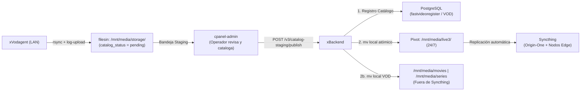

# REQ-2026-011: Paso Intermedio de Catalogación y Publicación a Producción (`filesin` → `cpanel-admin` → `Live3 / VOD`)

| Metadato | Detalle |
| :--- | :--- |
| **ID Requerimiento:** | `REQ-2026-011` |
| **Sistema Destino:** | `Cross_System` (`xBackend` / `xServerSQL` / `cpanel-admin`) |
| **Estado:** | `02_Aprobado` |
| **Severidad / Prioridad:** | Alta / Operativa |
| **Fecha de Creación:** | 2026-11-12 |
| **Última Actualización:** | 2026-11-12 |
| **Autor(es):** | Lead Architect (Planning-X / Antigravity) |
| **Motor de Programación:** | **Claude Code** |

---

## 1. Resumen Ejecutivo y Justificación

Actualmente `xVodagent` deposita los archivos `.mp4` normalizados en `filesin` (`/mnt/media/storage/`) y registra la transferencia en `media_upload_logs` (`POST /api/v1/sync-agent/log-upload`), mientras que **Syncthing** replica hacia producción (`Origin-One` y nodos edge `xManager`/`xFast`) únicamente lo que reside en las carpetas productivas (`Live3`: `/mnt/media/live3/`).

Este requerimiento implementa el **paso intermedio asistido por operador en `cpanel-admin`** entre la zona de ingesta (`filesin:/mnt/media/storage/`) y las carpetas productivas, cubriendo **canales 24/7, películas y series**:
1. Todo archivo recibido en `/mnt/media/storage/` permanece en estado **`pending`** (staging) sin replicarse aún a producción.
2. En `cpanel-admin`, el operador visualiza la bandeja de archivos recién llegados, inspecciona sus metadatos técnicos (`ffprobe`), completa/confirma la ficha de catálogo y aprueba la publicación.
3. Al aprobar, `xBackend` registra el contenido en la base de datos de producción y **mueve localmente** el archivo hacia la carpeta destino correspondiente.

---

## 2. Filtro Doctrinal (Engineering Rules)

### 2.1. Filtro Británico (*Keep it Plain*)
- **Sin Nuevos Daemons ni Tablas Redundantes:** Se reutiliza `media_upload_logs` agregando columnas de estado de catalogación (`catalog_status`, `published_at`, `published_by`, `published_path`, `catalog_ref_id`) en lugar de crear una tabla espejo paralela.
- **Movimiento Local Directo:** Dado que `filesin` (`/mnt/media/storage`) y `Pivot` (`/mnt/media/live3`, `/mnt/media/movies`, `/mnt/media/series`) residen en el mismo servidor, publicar consiste en un `fs.rename` (o `copy + unlink` si cruzan puntos de montaje).
- **Syncthing Intacto:** No se altera la topología Syncthing; sigue replicando automáticamente en cuanto el archivo aparece en `/mnt/media/live3/`.

### 2.2. Filtro Alemán (*Gründlichkeit*)
- **Rutas y Flujo Diferenciado por Tipo de Contenido:**
  - **Canales 24/7 (`24_7_channel` — Etapa 1):** Registra en `videos` + `channelvideos` mediante `fastvideoregister.sql` (`localpath = 'live3/<channel_slug>'`) y mueve a `/mnt/media/live3/<channel_slug>/<filename>` (**sincronizado por Syncthing `Live3`** hacia `Origin-One` y nodos edge).
  - **Películas (`movie`):** Destino físico **`/mnt/media/movies/`** (**NO** sincronizado por Syncthing para evitar saturar espacio en los nodos edge; consumido por el servicio VOD externo o replicación selectiva).
  - **Series (`tv_show`):** Destino físico **`/mnt/media/series/`** (**NO** sincronizado por Syncthing).
- **Planificación por Etapas:**
  - **Etapa 1 (Inmediata):** Bandeja de Staging en `cpanel-admin` para `24_7_channel` (publicación completa vía `fastvideoregister` $\to$ `/mnt/media/live3/<canal>/`) + clasificación y movimiento físico de `movie` $\to$ `/mnt/media/movies/` y `tv_show` $\to$ `/mnt/media/series/`.
  - **Etapa 2 (Siguiente Fase):** Reforma del panel antiguo de VOD para integrar la búsqueda/asignación de **`tmdb_id`**, carátula y sinopsis (`populatemovies` / `setepisodes`) directamente desde esta bandeja antes de publicar.
- **Contratos RPC (`xServerSQL`):** Toda operación SQL respeta la firma estándar `(_data jsonb, _params jsonb, _operator jsonb) returns jsonb`.

### 2.3. Filtro Ruso (*Nadezhnost* - Resiliencia L1/L2/L3)
- **L1 (Edge Cases):** Archivo borrado manualmente en `/mnt/media/storage` antes de publicar (`ENOENT`), colisión de nombre en la carpeta destino, falta de `tmdb_id` en VOD o canal inexistente en 24/7.
- **L2 (Atomicidad DB ↔ Filesystem):** Si falla el movimiento en disco, no se confirma el estado `'published'` en PostgreSQL. Si falla el RPC SQL tras mover el archivo, `xBackend` revierte el movimiento devolviendo el `.mp4` a `/mnt/media/storage/`.
- **L3 (Concurrencia):** Actualización atómica `WHERE catalog_status = 'pending'` al iniciar la publicación para impedir que dos operadores publiquen simultáneamente el mismo archivo.

---

## 3. Flujo Operativo y Arquitectura

---

## 4. Cambios Concretos Propuestos

### 4.1. Base de Datos (`xServerSQL`)
- **Migración sobre `media_upload_logs`:**
  - `catalog_status varchar(20) NOT NULL DEFAULT 'pending'` (`pending`, `published`, `rejected`)
  - `published_at timestamptz`
  - `published_by varchar`
  - `published_path text`
  - `catalog_ref_id varchar` (ej. `videoid` o `stream_id`)
- **Funciones PL/pgSQL:**
  - `catalogstaginglist(_data, _params, _operator)`: Lista registros de `media_upload_logs` con `status in ('completed', 'duplicate_skipped')` y `catalog_status = 'pending'`, filtrables por `contentType`.
  - `catalogstagingmark(_data, _params, _operator)`: Marca un `logId` como `published` o `rejected` de forma atómica verificando `catalog_status = 'pending'`.

### 4.2. Backend (`xBackend`)
- Nuevas rutas bajo `/v3/catalog-staging/`:
  - `GET /v3/catalog-staging/pending`: Consulta `catalogstaginglist` y verifica existencia física en `/mnt/media/storage/`.
  - `POST /v3/catalog-staging/probe`: Ejecuta `ffprobe` local sobre `remote_path` para devolver duración, codec, resolución y audio al operador.
  - `POST /v3/catalog-staging/publish`:
    1. Valida `catalog_status = 'pending'` y existencia del archivo origen.
    2. Según `contentType`:
       - `24_7_channel`: ejecuta `fastvideoregister` y mueve hacia `/mnt/media/live3/<channel_slug>/`.
       - `movie`: mueve hacia `/mnt/media/movies/` (en Etapa 2 integra TMDB/`populatemovies`).
       - `tv_show`: mueve hacia `/mnt/media/series/` (en Etapa 2 integra TMDB/`setepisodes`).
    3. Marca `catalog_status = 'published'` vía `catalogstagingmark`.
  - `POST /v3/catalog-staging/reject`: Marca `'rejected'` y mueve/elimina el archivo de staging según opción del operador.

### 4.3. Frontend (`cpanel-admin`)
- Nueva vista **"Catalogación de Ingesta (Staging)"**:
  - Tabs por tipo: **Canales 24/7**, **Películas**, **Series**.
  - Tabla con archivo, tamaño, hash, agente origen, fecha de llegada y estado en disco.
  - Modal de publicación: muestra metadata `ffprobe`, permite editar título/nombre visible, seleccionar canal destino (24/7) o preparar campo `tmdb_id`/temporada/episodio (Etapa 2 para VOD), y botón **"Publicar a Producción"**.

---

## 5. Escenario de Pruebas (Filtro Ruso)
- [ ] **L1:** Intentar publicar un `logId` cuyo archivo fue borrado de `/mnt/media/storage/` $\to$ debe devolver error controlado sin marcar `published`.
- [ ] **L2:** Publicar un `.mp4` 24/7 $\to$ verificar fila creada en `videos` + `channelvideos`, archivo movido de `/mnt/media/storage/247/...` a `/mnt/media/live3/...`, y `catalog_status = 'published'`.
- [ ] **L2 (VOD):** Publicar una película/serie $\to$ verificar movimiento atómico a `/mnt/media/movies/` o `/mnt/media/series/` sin activar Syncthing.
- [ ] **L3:** Dos peticiones simultáneas de `publish` sobre el mismo `logId` $\to$ una gana y la otra recibe rechazo por estado no pendiente.
