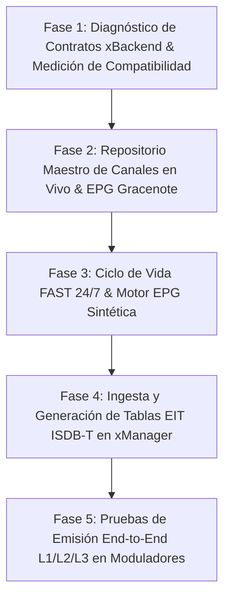

# RFC-2026-002: EPG ISDB-T, Repositorio Maestro de Canales en Vivo, Ciclo FAST 24/7 y Evolución de xBackend

## 1. Resumen Ejecutivo y Alcance

Este documento establece el plan integral de arquitectura y requerimientos técnicos para:
1. **Evaluar la viabilidad de modernización / refactorización de `xBackend` vs. creación de un `xBackend 2.0`**, garantizando la compatibilidad con los contratos consumidos por `xManager` (`console.xisrv.xyz`) y el ecosistema de medios actual.
2. **Implementar el Repositorio Source Maestro de Canales en Vivo y la ingesta centralizada de EPG** utilizando la API de Gracenote.
3. **Formalizar el Ciclo de Vida de Contenidos para Canales 24/7 (FAST)** y el motor de generación de **EPG Sintética ("Inventada")** a partir de los metadatos VOD.
4. **Diseñar el pipeline de inyección y entrega de EPG hacia moduladores ISDB-T** en los nodos de transmisión administrados por `xManager`.

---

## 2. Diagnóstico Técnico: xBackend Actual vs. xBackend 2.0

### 2.1. Estado de Situación de xBackend
- **Patrón Arquitectural:** Thin Controllers en Express/TypeScript que serializan requests en `[_data, _params, _operator]` y ejecutan procedimientos almacenados en PostgreSQL (`xServerSQL`).
- **Consumo desde xManager:** `xManager` consulta activamente endpoints bajo `/v1/tenant/...` y `/v2/tenant/...` (canales en vivo, categorías, películas, series, episodios) contra `console.xisrv.xyz`.
- **Brecha Detectada:** 
  - Desfase en la gestión de rutas y estructuras de carpetas de almacenamiento (`/mnt/media/egress/...`, almacenamiento distribuido).
  - Mezcla de controladores legacy (`tenants.ts`, `channels.ts`, `tmdb.ts`) con versiones v2 incompletas (`tenantsV2.ts`, `tmdbV2.ts`).
  - Falta de un modelo relacional normalizado para el repositorio maestro de canales en vivo y sus fuentes (sources/ingestas redundantes).

### 2.2. Recomendación Doctrinal (Doctrina Británica - Simplicidad Radical)
> **Dictamen:** **No construir un sistema desde cero (xBackend 2.0 aislado)**. Se recomienda una **Modernización Quirúrgica Incremental de xBackend** manteniendo la base de datos PostgreSQL (`xServerSQL`) y el patrón de Thin Controllers, aplicando:
1. Depuración y poda de endpoints obsoletos (`/v1` legacy no utilizados).
2. Estandarización estricta de la API `/v2` y `/v3` para consumo de `xManager` y `cpanel-admin`.
3. Consolidación de procedimientos almacenados en `xServerSQL` para soportar el repositorio maestro de canales y EPG.

---

## 3. Repositorio Source Maestro de Canales en Vivo y EPG Gracenote

```
 ┌──────────────────────┐
 │   Gracenote / TMS    │
 │       API v1.1       │
 └──────────┬───────────┘
            │ Poll Grilla / Airings
            ▼
 ┌────────────────────────────────────────────────────────┐
 │                        xBackend                        │
 │  ┌──────────────────────────────────────────────────┐  │
 │  │      Repositorio Maestro de Canales en Vivo      │  │
 │  │ (Canal Canónico, Station ID, Headend, Logos)     │  │
 │  └──────────────────────────┬───────────────────────┘  │
 │                             ▼                          │
 │  ┌──────────────────────────────────────────────────┐  │
 │  │        Motor de Ingesta y Normalización EPG       │  │
 │  │  (Tabla `epg_airings`: Start, End, Title, Descr) │  │
 │  └──────────────────────────────────────────────────┘  │
 └─────────────────────────────┬──────────────────────────┘
                               │ Sincronización REST / JSON / XMLTV
                               ▼
 ┌────────────────────────────────────────────────────────┐
 │                        xManager                        │
 │  - Caché Local de EPG                                  │
 │  - Generador de Tablas EIT / SI para ISDB-T            │
 └─────────────────────────────┬──────────────────────────┘
                               │ Multiplexación / Inyección TS
                               ▼
 ┌────────────────────────────────────────────────────────┐
 │                 Moduladores ISDB-T                     │
 └────────────────────────────────────────────────────────┘
```

### 3.1. Entidades en Base de Datos (`xServerSQL`)
- `master_live_channels`: ID canónico, nombre estándar, categoría, station_id (Gracenote), logo_url, estado, fuentes stream disponibles (primaria, backup).
- `epg_airings`: ID del evento, canal_id / station_id, fecha/hora inicio (UTC), fecha/hora fin (UTC), título, subtítulo, descripción, clasificación por edad, categoría temática.

### 3.2. Sincronizador Gracenote
- Worker programado (`base/clock.ts` o cron central) que consulta por lotes (`airings`) para una ventana rodante (ej. 7 a 14 días).
- Manejo defensivo de rate-limits y almacenamiento en PostgreSQL mediante UPSERT (`ON CONFLICT DO UPDATE`).

---

## 4. Ciclo de Vida FAST 24/7 y EPG Sintética ("Inventada")

### 4.1. Ciclo de Vida del Contenido 24/7
1. **Ingesta / Registro:** Asignación de assets VOD (películas, series, episodios) a un canal FAST temático.
2. **Programación / Playout Grid:** Regla de rotación (secuencial, aleatoria ponderada, franjas horarias).
3. **Mantenimiento y Depuración:** Reemplazo de títulos obsoletos, detección de archivos corruptos o faltantes.

### 4.2. Motor de Generación de EPG Sintética
- A partir de la lista ordenada de reproducción y la duración exacta (`duration_seconds`) extraída por FFprobe / TMDB:
  $$\text{StartTime}_{n+1} = \text{StartTime}_n + \text{Duration}_n$$
- El motor calcula la grilla de emisión futura (7 días hacia adelante) proyectando la secuencia continua de contenidos.
- Se genera un registro formal en la tabla unificada de EPG, idéntico en estructura al de Gracenote, conteniendo:
  - Título del VOD / Episodio.
  - Sinopsis oficial obtenida de TMDB.
  - Año, Género y Duración.

---

## 5. Integración y Entrega de EPG en ISDB-T (xManager & eit-stream)

### 5.1. Mecanismo de Inyección en Transmisión Broadcast
En el estándar ISDB-T/DVB, los receptores de televisión leen la guía desde la tabla **EIT (Event Information Table)**:
- **EIT Present/Following (p/f):** Información del programa actual y del siguiente (actualización de alta frecuencia, cada 1-2 segundos).
- **EIT Schedule:** Grilla de programación extendida (ventana de 24 a 48 horas).

### 5.2. Pipeline de Generación e Inyección con `eit-stream`
```
 ┌────────────────────────────────────────────────────────┐
 │                        xBackend                        │
 │  - Repositorio Maestro Gracenote (Canales en Vivo)     │
 │  - EPG Sintética por Franjas Horarias (Canales 24/7)   │
 │  - Endpoint /v2/epg/xmltv (Formato XMLTV estándar)     │
 └──────────────────────────┬─────────────────────────────┘
                            │ HTTP GET (XMLTV)
                            ▼
 ┌────────────────────────────────────────────────────────┐
 │                        xManager                        │
 │  ┌──────────────────────────────────────────────────┐  │
 │  │        Orquestador de Configuración eit-stream   │  │
 │  │ (Generación de config.json: TSID, PNR, xmltv-id) │  │
 │  └──────────────────────────┬───────────────────────┘  │
 │                             │                          │
 │  ┌──────────────────────────▼───────────────────────┐  │
 │  │       Motor `eit-stream` (Cesbo Astra Tool)      │  │
 │  │  (Conversión XMLTV -> Tablas EIT MPEG-TS PID 18) │  │
 │  └──────────────────────────┬───────────────────────┘  │
 └─────────────────────────────┼──────────────────────────┘
                               │ UDP Multicast / MPTS Pass EIT
                               ▼
 ┌────────────────────────────────────────────────────────┐
 │                 Moduladores ISDB-T                     │
 └────────────────────────────────────────────────────────┘
```

1. **`xBackend`** expone el feed XMLTV consolidado (`/v2/epg/xmltv`).
2. **`xManager`** genera el archivo de mapeo `/etc/eit-stream/config_ts{X}.json` asociando cada `xmltv-id` al `pnr` (Service ID / Program Number) y `tsid` correspondiente al TS modulado:
```json
{
  "multiplex": {
    "tsid": 1,
    "onid": 1,
    "name": "MUX-ISDBT-01"
  },
  "services": [
    {
      "pnr": 101,
      "xmltv-id": "espn.hd"
    },
    {
      "pnr": 102,
      "xmltv-id": "fast.cine.accion"
    }
  ],
  "output": "udp://239.255.1.1:5000"
}
```
3. **`eit-stream`** corre como demonio o proceso gestionado por `xManager`, inyectando las tablas EIT en el MPTS del modulador ISDB-T.

---

## 6. Plan de Ejecución Segmentado (ToDo)



### Fase 1: Diagnóstico de Contratos y Compatibilidad xBackend
- [ ] Auditar todos los endpoints consumidos por `xManager` (`channelsV2.ts`, `admin.ts`, `cdn.ts`).
- [ ] Mapear discrepancias entre la estructura actual de medios (`egress`, mounts locales) y los modelos de datos en `xServerSQL`.
- [ ] Formalizar la especificación de contratos v2/v3 para `xBackend`.

### Fase 2: Repositorio Maestro de Canales en Vivo & Ingesta Gracenote
- [ ] Crear DDL en `xServerSQL` para `master_live_channels` y `epg_airings`.
- [ ] Implementar cliente Gracenote robusto con control de cuotas, cache y reintentos.
- [ ] Endpoint de exportación de EPG unificada (`/v2/epg/grid`, `/v2/epg/xmltv`).

### Fase 3: FAST 24/7 & EPG Sintética
- [ ] Normalizar la estructura de canales FAST en base de datos.
- [ ] Desarrollar generador determinista de grilla futura basado en duraciones VOD.
- [ ] Unificar la salida de EPG sintética con el formato estándar de Gracenote.

### Fase 4: Integración ISDB-T en xManager
- [ ] Desarrollar módulo en `xManager` para consumir la EPG unificada de `xBackend`.
- [ ] Implementar generador de tablas EIT (Present/Following y Schedule) compatible con ISDB-T (codificación de caracteres y descriptores ARIB/DVB).
- [ ] Configurar flujo de multiplexación hacia moduladores certificados.

### Fase 5: Protocolo de Pruebas L1, L2 y L3
- [ ] **L1:** Pruebas unitarias de parsing Gracenote, superposición de horarios y duraciones cero o nulas.
- [ ] **L2:** Verificación de contratos JSONB `[_data, _params, _operator]` y compilación TypeScript en `xBackend` y `xManager`.
- [ ] **L3:** Pruebas de emisión real en TS de Pruebas (TS16) de moduladores de laboratorio/producción, verificando lectura de EPG en TV física / set-top box ISDB-T.
